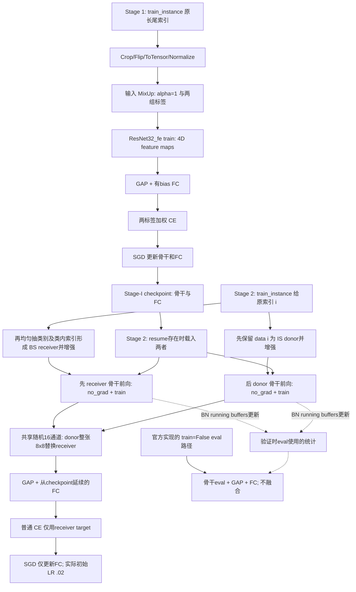

# 原始 H2T 非骨干模块机制审计

审计日期：2026-10-26。分支：`audit/h2t-component-map-20261026`；HEAD：`9a89df6dbe9f89c80dfd8792a7e06137333d2233`。本报告为静态代码、配置和论文证据审计；未导入训练模块、未构建或运行模型、未载入 checkpoint、未读取 CIFAR 数据、未使用 GPU。任何 `ACTIVE_STATIC` 均指在本报告选定 YAML、`opts=[]` 且前置资源有效的条件下，控制流将到达该组件，不是实际训练运行的观测。

## 结论与证据边界

真正直接界定 H2T 的组件是：两种采样边际形成的接收者/供体、池化前的随机整通道替换、替换比例与通道选择策略、只保留接收者标签的监督，以及两阶段中固定表示参数并调整分类器的框架。代码的供体是实例分布采样，头类出现概率较高，并没有显式限定为头类；接收者类别均衡，也没有限定只对尾类做融合。MixUp、随机裁剪/翻转、输入标准化、BN、普通 FC、SGD、学习率调度及并行包装是所发实现继承或选用的训练基础设施，不能整体记作 H2T 新增模块。

本轮确认了三个直接影响机制解释的事实：Stage 2 实际传入 `train_instance`，但均衡接收者采样在 dataset 内部完成；`shift_bn=True` 让骨干处于 train 模式，因此 no_grad 和只优化 FC 不等于固定 BN buffers；分类头是带 bias 的普通线性层，Stage 2 实际首轮学习率为 `0.1×0.2=0.02`。这些结论分别来自调用链、模式控制及调度器代码，不是性能因果结论。

本报告使用冻结源 `H2T_official_clean/H2T-main/`，没有替换为另一个 official 副本、实验变体或 PI-H2T。该目录还包含先前辅助脚本和结果，目录名本身不能证明每份文件都是作者上游原件；本报告以 README 指向的 `train_stage1.py` / `train_stage2.py` 核心入口及其实际依赖作为主证据。静态清单覆盖 75 个文本源文件；原目录全部 269 个文件另有逐字节 SHA-256 基线与结束对照。初始工作区已有三个未跟踪实验目录，详见验证报告，未处理这些目录。

## 证据记号与来源

- `CODE`：完整函数体和调用者控制流；行号均对应本轮 manifest 中的源码版本。
- `CONFIG`：`utils/__init__.py:5-6` 引入 `utils/logger.py`；后者 `96-100` 按默认值→YAML→CLI remainder 合并。两份 YAML 不等于实际运行参数。
- `PAPER`：原论文版本 v3（2023-12-18），13 页；按 PDF 物理页码引用；原文和附录已读取，关键公式及表格已渲染复核。[原论文](https://arxiv.org/pdf/2306.06963v3)。副本与 SHA-256 位于 `paper_evidence/paper_provenance.json`。
- `PUBLISHED_ABLATION`：论文已经给出的对照，明确保留其协议与混杂因素，不冒充本轮复现。`ALREADY_TESTED` 仅指该行描述中明确列出的部分已有论文对照。
- `CODE_DERIVED_EXPECTATION`：对可执行行为的推导，不是对精度升降的实验结论。`runtime=NONE` 适用于全部行。

|论文证据ID|已核验位置|可支持的范围|不能据此推出|
|---|---|---|---|
|P1|PDF pp.3–4，Sec.3.3，Eq.(1)–(2)，Algorithm 1|双采样、特征替换、接收标签、两阶段/固定表示参数|BN buffers 冻结；显式 head-only / tail-only 筛选|
|P2|PDF p.10，Appendix A，Listing 1|随机通道、整张空间图替换、batch 共享索引、int 截断|当前多专家 list 接口可执行；H2Tv2 被启用|
|P3|PDF p.7，Sec.4.4，Table 5|BS+RS / BS+BS / BS+IS 的论文协议比较|接收者 BS、BN 或 MixUp 的独立贡献|
|P4|PDF p.7，Sec.4.4，Figure 6|替换比例的已发表比较与头尾权衡|所选 rho=0.25 等同于论文 p=0.3|
|P5|PDF p.10，Appendix C，Table 7|固定首/中/末与随机通道的比较，随机五次结果|共享掩码与逐样本掩码的独立比较|
|P6|PDF p.5，Sec.4.2|SGD、momentum、Stage 1 的预算与主要调度、Stage 2 10轮|当前分类器参数组实际直接使用0.1；每个细节都有消融|

本地 `slides and poster/AAAI24-H2T-slides_422.pdf` p.3 与 poster p.1 提供辅助交叉核对：BS 接收分支、IS 供体分支、只用接收分支标签。文本提取副本、页数和原文件哈希保存在 `paper_evidence/`；性能数字以论文表格为准。论文 Eq.(1) 的掩码计数有口径歧义，详见融合章节，未按推测改写原文。

下文除另列前缀外，所有源码路径均相对于 `H2T_official_clean/H2T-main/`；矩阵的 `definition_path` / `callsite_path` 保留仓库相对完整路径。表格集中列出 42 行组件，不把相关的基础架构项算成新增方法。

## 配置解析与真实入口

命令行解析在 `train_stage1.py:41-55`、`train_stage2.py:44-58` 接收 `opts`；`utils/logger.py:99-100` 的 `merge_from_file` 后还有 `merge_from_list`。以下是无 CLI 覆盖条件下的静态解析；`CONFIG_RESOLUTION.json` 保存所有可从字面量恢复的默认值、其行号、YAML 值及合并结果。此解析器不导入 YACS 或 H2T，也不声称能解析任意复杂 YAML。

|控制项|Stage 1|Stage 2|证据/实际分支|
|---|---|---|---|
|所选YAML|`config/cifar100/cifar100_imb001_stage1_ce_mixup.yaml`|`config/cifar100/cifar100_imb001_stage2_ce_H2T.yaml`|两份配置完整读取|
|数据及骨干|CIFAR100，100类，imb_factor=0.01；resnet32_fe|相同|S1配置9–13；S2配置9–11,23；入口工厂S1:114/S2:116|
|预算/批量|200轮 /128|10轮 /128|S1配置40,42；S2配置54,56；未运行|
|接收者采样|默认sampler.type=default，保留实例索引|weighted sampler /balance|默认`utils/logger.py:21-23`；S2配置15–17；dataset:103–113|
|供体|dual.enable=False|True / long-tailed，沿原索引|默认26–27；S2配置19–20；dataset:83–101|
|实际loader|train_instance|train_instance；train_balance调用被注释|S1:212，S2:231–232|
|MixUp|True，alpha=1|False，alpha=null|配置44–45 /58–59；输入层混合与特征替换分开|
|H2T|默认-1，Stage1没有调用|0.25，64通道中替换16|默认93；S2配置60；methods.py:35|
|骨干模式/更新|train，骨干+FC均更新|shift_bn=True→train；骨干no_grad且不进SGD；BN buffers仍可更新|S1:302–303,231；S2:313–317,360–378,241|
|分类器|默认config.classifier=Classifier|CIFAR分支硬编码Classifier|默认31；S1:115，S2:117；Classifier定义resnet_cifar.py:155|
|损失/extra_info|默认CrossEntropyLoss /False|相同；无类权重|默认53–56；S1:223，S2:239；root loss.py:8–29|
|优化器|SGD，momentum .9，wd 2e-4，骨干+头两组|SGD，momentum .9，wd 5e-4，仅头一组|S1配置39–43 / S2配置53–57；优化器S1:231–234/S2:241–244|
|学习率实现|基值.1；默认multistep [160,180]，另有5轮warmup|cosine；首组额外乘.2，epoch0实际.02|S1:457–475 /S2:487–497；S2函数不依据type字符串分支|
|随机/包装|deterministic=True→SetRandomSeed(123)|False→跳过该helper；非分布式gpu=None条件下DataParallel|S1:70–71；S2:72–94,178–179；未查询GPU或实际副本数|
|默认resume|`current.pth.tar`|`./cifar100_imb001_stage1.pth.tar`|S1配置14 /S2配置24；相对冻结源根检查均未存在，未做替换|

S2 的 resume 分支 `184-208` 在文件存在时同时加载 `state_dict_model` 和 `state_dict_classifier`，载入后没有重新初始化 FC；也未恢复 checkpoint optimizer。缺文件只写日志而不强制停止。现有 `pretrained/cifar100_imb001_stage1_official.pth.tar` 名称不同，本轮未更改路径、未反序列化它。因工作目录及 CLI 可以另行指定路径，这项是**按默认相对路径的可运行性缺口**，不是某次历史训练未加载权重的证明。

YAML 的头/中/尾汇报分组为 `[0,36)` / `[36,71)` / `[71,100)`（S1:15–23；S2:25–33）。它们没有传入 H2T 来限制哪些接收者可融合，不能把分组汇报代码当作方法筛选条件。

## 方法、数据与训练流

流程图描述源码而非本轮执行记录。dataset 内增强顺序是 donor→receiver；模型前向顺序是 receiver→donor，两者不要混淆。所选 Stage 2 中两个特征期望都是 `[B,64,8,8]`，FC 接收池化后的 `[B,64]` 并输出 `[B,100]`；形状来自32×32输入及 `[5,5,5]` blocks/stride 的静态推导，不是本轮测得张量。

## 特征融合：精确机制与论文口径

实际路径为 `train_stage2.py:360-378` → `methods.py:31-47`。四维 Tensor 分支在通道维做一次 `torch.randperm(x1.shape[1])`，截取 `int(rho*C)` 个索引，再执行 `x1[:,index]=x2[:,index]`。同一个索引向量供整个 batch 使用，每个选中通道的所有空间位置被同坐标供体通道整体覆盖；不是按像素、逐样本、按激活大小或语义得分挑选，也没有显式相似度过滤或 learnable attention。该函数没有可学习参数。`resnet_cifar.py:148-153` 返回池化前图，`161-164` 的 GAP 和 FC 发生在融合后。

所选 `H2T=0.25` 明确覆盖函数默认0.3：64通道替换16、保留48。代码参数名 `rho` 是**被供体替换比例**；论文第5页数据集的 `rho=nmax/nmin` 是不平衡比，融合强度另记为 `p`，不可混用。论文 Figure 6 的主分析 p=0.3 也不能视作本份 YAML 的0.25；README:94,97 另列本仓库配置重跑47.80，论文表中47.73为另一个明确来源。

论文 PDF p.3 Eq.(1) 写 `M_p⊙F_t + complement(M_p)⊙F_h`，紧邻文字把 `M_p` 中1的个数写为 `[d p]`；若按此字面解释，p是保留接收者的比例。附录 p.10 Listing 1 却以 `int(rho*d)` 选择被供体覆盖的通道，Figure 6 的文字也按替换强度解释。这里存在**掩码正反极性/符号口径的表观歧义**，本轮不推断作者意图或擅改公式。执行语义以已核验 Listing 1 与源码赋值为准。

融合后仍使用接收者硬标签 `target`（Stage2:378）；`sample_label` 在 dataset:101 生成但该分支没有读入损失。没有对供体标签进行 MixUp，也没有为标签分配 rho 权重。移除/替换标签规则会改变优化目标，其性能方向未被当前证据独立确定。

`H2Tv2`（methods.py:50–67）是距离/类别信息加权的线性特征混合类，不由上述调用链引用；不能把它的机制解释成实际 H2T。`H2T` 的非4D分支虽然写了逐专家循环，但入口先取 `x1.shape`；Python list 没有该属性。RIDE 特征列表与此接口的潜在不兼容只作静态问题记录；选定 CIFAR 四维路径不会触发，原文件未修改。

## 双采样与接收者/供体的实际构造

`datasets/cifar100.py:190-208` 同时构造 `train_instance` 和 `train_balance`。Stage2:231 明确把前者传给 `train`，后者在232仅为注释。前者的 `shuffle=True` 沿原长尾子集索引遍历；真正改变接收者分布的是 `IMBALANCECIFAR100.__getitem__`，而不是名为 ClassAware 的 loader。

`__getitem__:83-101` 先处理供体：`dual_sample.type='long-tailed'` 时 `sample_index=index`，保存并增强原索引图像；随后 `103-113` 在 `sampler.type='weighted sampler'`、weighted.type='balance' 下先均匀抽类别，再在该类随机抽样，覆盖接收者的 index 和 target。最后 `121-127` 增强并返回接收者。供体在 index 被改写前确定，因此 IS 的边际与原长尾频次一致；不是简单地对 BS 接收者再复制一次，也不是先筛头类再抽。代码只有一个实际训练 loader，不能把双分支描述成两个完全独立 DataLoader。

供体和接收者均可能来自任何类别，甚至偶然是同一底图，但各自独立调用随机增强。`dual_sample` 的 config node 在 dataset:23 被当作布尔条件来预构建辅助表，与实际 `getitem:83` 检查 `.enable` 是两处不同控制；不能用辅助表存在来证明双采样已启用。所选enable=True的Stage2满足执行条件。

`ClassAwareSampler`（sampler.py:130–179，默认每类4个样本）仍被构造，但对应 loader 未迭代。其长度是 max(n_i)×C，和长尾数据集N不同；切换过去还会改变单轮步数，而不是一个中性的等价替换。BalancedDatasetSampler、EffectNumSampler 及 reverse 分支是其他备选实现，分别在矩阵列出，不能因类名或关键字出现即算作选定路径激活。

## 归一化与 BN：参数冻结不等于状态冻结

CIFAR 骨干的 BN 见 `resnet_cifar.py:64,66,133`，未设置 affine=False 或 track_running_stats=False。Stage2:313–316 的逻辑是 `shift_bn=True → model.train()`，False 才会 `model.eval()`。所选前向位于 `360-370` 的 no_grad 中，SGD:241 仅包含 FC；因此骨干卷积及 BN affine 参数不由该损失反传或 SGD 更新，但 train 模式仍使用当前批统计并更新 running_mean/running_var/num_batches_tracked。

以上为代码结合标准框架行为的推导，没有测量本轮 BN 数值。PyTorch 文档明确区分 [no_grad 的梯度计算控制](https://docs.pytorch.org/docs/2.14/generated/torch.no_grad.html) 与 [BatchNorm2d 的 train/eval 统计规则](https://docs.pytorch.org/docs/2.14/generated/torch.nn.BatchNorm2d.html)。文档用于解释接口，不宣称此次运行安装版本就是2.14。

两个骨干前向的先后为 BS receiver→IS donor（Stage2:369）。在默认 BN momentum=.1、单一持久副本的抽象下，两次更新会把旧均值、receiver均值、donor均值分别赋予 .81/.09/.10 的 EMA 权重；这只是更新规则的代数示意，不是完整深层网络数值模型。实际 DataParallel 的 batch 分片及持久 buffer 行为还受设备包装影响，本轮未运行或查询。验证 `412-435` 转为 eval 后使用已保存统计；所以“固定了表示参数”与“整个推理特征映射和Stage1完全不变”必须分开。

关闭 H2T 在原训练控制流还会省去 donor 骨干前向，连带改变统计更新次数；设置 shift_bn=False 则既停止 EMA 又改变前向归一化依据。论文没有提供将这些因素逐项隔离的 BN 消融，不能从论文整体收益推出 BN 转移的单独贡献。输入固定 Normalize 与 BN、NormedLinear/余弦头又是不同层级的归一化。

## 分类头、损失与优化边界

工厂 `train_stage2.py:116-117` 选择 `resnet32_fe()` 和字面名称 `Classifier`；Stage1:115 才按 config.classifier 动态选头。CIFAR `Classifier:155-164` 是 GAP→flatten→`nn.Linear(64,100)`，包含默认bias，共6500个参数。该头没有 NormedLinear、LWS、Dropout、attention 或额外投影。论文 Sec.3.1 的线性理论简式未单列bias，不能直接拿理论式取代真实实现。

`loss.py` 是两入口 `from loss import *` 引入的根目录文件；并非 `models/ride_model/loss.py`。默认 `loss.type='CrossEntropyLoss'`（logger.py:53）未被两份 YAML 覆盖，工厂在 S1:223 /S2:239 构造，根目录 loss.py:28–29 调用标准CE。Stage2 mixup=False，extra_info=False，因此仅有接收者硬标签的无类权重CE。`config.loss.CE.reweight_CE` 虽存在，但构造函数读取的是独立参数 `reweight_CE=False`，入口没有传它；只改 config 字段不等于该项已生效。

LabelAwareSmoothing、LDAM、RIDELoss（含diversity和额外信息）、ResLoss、Focal/蒸馏均有定义而未显示在该路径激活。它们的接口并不自动互换：例如平滑损失构造参数不同，ResLoss需要三组logits，RIDE的extra_info=None还会退回base CE（loss.py:232–234）。Stage2:249,253重复调用可选criterion epoch hook，选定CE没有这个hook，故本路径不受影响；没有执行备选组合来验证其运行性。

Stage2只有FC参数组，学习率在 `487-497` 无条件走cos公式，首组再乘 `lr_factor=.2`；epoch0是.02而非名义.1。Stage1 `457-475` 另有5轮warmup和multistep逻辑，先把epoch加1再与阈值比较，报告以代码条件为准。SGD的momentum、wd、bias参与参数组等属于所选优化协议；没有据此宣称某项独立提高准确率。

## 输入增强、训练技巧与汇报

`methods.py:8-28` 的 MixUp 在输入层混图，用Beta(1,1)的batch级系数与随机配对生成双标签加权CE；Stage1:320–335启用，Stage2配置明确关闭。H2T在特征层做硬通道替换且只用接收者标签，两者不能合称同一个混合模块。Stage1有MixUp也意味着它影响checkpoint来源，不能把更换Stage1增强当成只研究Stage2融合。

dataset:175–180 的 RandomCrop(32,padding=4)、RandomHorizontalFlip、ToTensor、Normalize 是常规训练增强；eval:184–187只做ToTensor/Normalize。长尾子集按 `int(500×0.01^(c/99))` 截取，数据构造 rand_number=0（190–192），类别ID按原顺序。这些处理共同定义采样边际；没有逐项消融证明其精度贡献。

确定性控制也必须按分支读：Stage1配置True才调用SetRandomSeed(123)，Stage2False会跳过该helper，不能据此断言所有cuDNN/TF32等flag已显式设置为False。未查询运行后端，也未运行训练入口。

验证路径把模型/头设eval，直接输出预测，没有H2T。CIFAR构造器 `194` 的 eval 集来自官方 `train=False` 数据，入口逐轮验证并按 Overall（Stage2:262–269）选best，ECE和head/med/tail用于汇报，未进入所选loss。**这是原实现的评估/选模协议发现，不是本轮读取了官方TEST。** 若后续讨论独立验证集表现，不能把此源码协议误称为另设了独立验证集。

## 可选/未激活组件与纯架构细节

矩阵逐项区分 `defined, not shown active on this path` 与 ACTIVE_STATIC。H2Tv2、LWS、NormedLinear、LabelAwareSmoothing、LDAM、RIDELoss、ResLT三头、替代sampler、多专家RIDE、Dropout、Focal和蒸馏均未接到选定CIFAR分支。定义和注释掉的调用不能当作启用证据，num_experts字段出现也不能将单骨干自动变成RIDE。

注意力缺席结论来自完整结构追踪：resnet32_fe:171→ResNet_fe:128–153→BasicBlock:61–87→Conv/BN/ReLU和option-A shortcut→返回4D图，再进Classifier:161–164，没有通道或空间注意力层。残差捷径、stride切片/零填充、ReLU及Kaiming初始化是骨干实现细节，列出是为了防止误归因，不作为本轮新增非骨干方法。

所有16个模型Python文件及两份loss文件均已纳入查阅。替代 `EAResNet.py:241-254,267-308` 和 EAResNeXt 的同名方法确有attention-like专家路由：归一化池化特征+top-k logits进入MLP，训练有BCE，推理用sigmoid阈值决定继续专家；这不是选定骨干的SE/CBAM通道注意力，也不是H2T随机替换的依据。RIDEResNet/ResNeXt另有可选dropout、归一化线性头及专家聚合，RIDE CIFAR返回列表的接口也与普通4D骨干不同。root ResNet/Places的大图像分支、Bottleneck/groups/dilation等属于其他架构路径。

原 README:22 已说明其他数据集/基线接口未完全整合。本轮查到的相关静态问题均保留原样：Stage2:30–32导入被注释，但其他dataset分支122/127仍引用ride_resnet/ride_resnet_places；DDP特定gpu分支151引用未绑定lws_model；model wrapper引入缺失base及ea_resnet_cifar等文件；RIDE的某Classifier.forward访问未在其构造器定义的use_dropout。它们不是选定CIFAR、非分布式路径已经触发的错误，也不是可以仅凭AST无报错就确认可运行的可选组件。

## 已有对照与尚未验证的效应

以下数字是从原论文核验的百分比，不是本地新实验。Table 5 的 DR w.o. H2T 与Table1脚注的MixUp口径要一起读；它不能自动等价于在所选代码删去一行赋值、其余状态全同的对照。

|原论文Table 5（CIFAR100-LT IF100）|Head|Med|Tail|All|
|---|---:|---:|---:|---:|
|CE|67.86|38.51|5.66|39.55|
|DR w.o. H2T|63.67|46.63|22.21|45.68|
|BS+RS|63.56|48.60|24.07|46.87|
|BS+BS|62.72|49.14|25.93|47.30|
|BS+IS|62.00|50.17|27.07|47.73|

Table 5在其协议下支持实例分布供体优于表中另外两种供体的结论；不单独证明接收者BS的收益，因为三个融合方案的接收者都是BS。Figure 6明确包含比例比较，正文报告p=.3时All47.73，p=1时All43.57，体现其协议中的头尾权衡。Table 7在30%替换下报告固定首/中/末通道All47.22/47.23/47.41，随机五次47.73/47.75/47.80/47.71/47.66，支持通道选择策略有影响，但没有比较batch共享与逐样本独立掩码。

Table1中MisLAS、RIDE等整体组合的收益只能作为跨方法兼容的报告证据，不能拆分为当前CE路径已开启这些loss/多专家、或某个独立模块的准确率增量。Table4的LC/CC为Places-LT上下文，不能当作当前CIFAR普通FC与归一化头的局部消融。README的47.80、论文的47.73与这次runtime=NONE保持分别标注。

## 逐组件机制表（42行、15列）

下表由人工核验条目生成；机器可读16列矩阵为同目录 `COMPONENT_EVIDENCE_MATRIX.csv`。每行的预测效应仅限所写代码行为；除明确列出的论文对照部分外，精度贡献均未验证。

|component|category|definition location|call location|inputs/outputs|paper-stated purpose|code-level mechanism|problem addressed|Stage 1 status|Stage 2 status|expected effect of removal/replacement|evidence class|existing ablation/result|confounders|open question|
|---|---|---|---|---|---|---|---|---|---|---|---|---|---|---|
|C01 H2T完整空间通道替换|Method-defining component|H2T_official_clean/H2T-main/methods.py:31|H2T_official_clean/H2T-main/train_stage2.py:370|两组[B,64,8,8]→原地修改receiver同形状特征|P1/P2：借用头偏置分支语义；原论文PDF pp.3-4, Sec.3.3, Eq.(1)-(2), Algorithm 1; 原论文PDF p.10, Appendix A, Listing 1; 原论文PDF p.7, Sec.4.4, Table 5|methods.py:31-47：一次randperm后按相同通道坐标复制供体；train_stage2.py:360-378在no_grad中调用，随后仅对receiver target算CE|尾类训练语义覆盖不足|未调用H2T|ACTIVE_STATIC（无CLI覆盖）|ALREADY_TESTED：移除后head只见未融合接收者特征；不会自动移除均衡采样或BN更新|CODE+CONFIG; runtime=NONE; PAPER（范围见引用）; PUBLISHED_ABLATION（不等于本地复测）|Table 5：DR w.o. H2T All=45.68，BS+IS=47.73；这是论文协议比较，不是本地单模块复测|论文DR基线还标注MixUp，不能当作只删一行融合的本地对照；原代码关闭H2T会把骨干前向由两次变一次并改变BN更新，论文未详列该控制|论文对照是否严格对齐BN状态与前向次数，不能由该表单独确定|
|C02 随机通道掩码及batch共享粒度|Method-defining component|H2T_official_clean/H2T-main/methods.py:34|H2T_official_clean/H2T-main/train_stage2.py:370|64通道→单个通道索引向量，供整批共享|P2/P5：通道选择策略；原论文PDF p.10, Appendix A, Listing 1; 原论文PDF p.10, Appendix C, Table 7|methods.py:34-37的index没有batch维；每次H2T调用重新randperm，不是逐样本掩码或按特征评分选择|避免固定选同一段通道|未调用|ACTIVE_STATIC（无CLI覆盖）|ALREADY_TESTED：改成固定通道会改变各坐标受扰动的频率；改成逐样本还会改变批内掩码相关性|CODE+CONFIG; runtime=NONE; PAPER（范围见引用）; PUBLISHED_ABLATION（不等于本地复测）|Table 7，替换30%：首/中/末=47.22/47.23/47.41；随机五次=47.73/47.75/47.80/47.71/47.66|Table 7没有比较batch共享和逐样本；比例0.30也不同于所选YAML的0.25|共享粒度的独立贡献没有在所读原论文中被单独验证|
|C03 融合比例及int取整|Method-defining component|H2T_official_clean/H2T-main/methods.py:35|H2T_official_clean/H2T-main/train_stage2.py:370|rho×64→int截断=16通道；保留48通道|P4：融合强度权衡；原论文PDF p.7, Sec.4.4, Figure 6; 原论文PDF p.10, Appendix A, Listing 1|methods.py:35-37定义的是供体替换比例；配置第60行为0.25，函数默认0.3被显式参数覆盖|控制扰动规模|H2T默认-1且Stage1无调用|ACTIVE_STATIC（无CLI覆盖）；H2T=0.25|ALREADY_TESTED：rho=0在入口跳过融合；增大时复制更多供体坐标，精度变化不能凭代码断言|CODE+CONFIG; runtime=NONE; PAPER（范围见引用）; PUBLISHED_ABLATION（不等于本地复测）|Figure 6扫描p；正文报告p=0.3的All=47.73，p=1的All=43.57；未在本轮复现|论文Eq.(1)掩码计数的字面口径与Listing 1有保留/替换歧义；README记录配置重跑47.80，不能混作论文47.73|paper p、代码rho及不同发布配置的对应应保持明确；0.25并非论文图中最优0.3|
|C04 接收者硬标签与不使用供体标签|Method-defining component|H2T_official_clean/H2T-main/datasets/cifar100.py:100|H2T_official_clean/H2T-main/train_stage2.py:378|target=y_receiver；meta.sample_label生成但不送入损失|P1：以被融合分支标签监督；原论文PDF pp.3-4, Sec.3.3, Eq.(1)-(2), Algorithm 1|dataset:100-101保存供体metadata；Stage2:325-326只取sample_image，378用criterion(output,target)，没有供体标签混合|固定虚拟特征的类别归属|原标签经MixUp参与双CE|ACTIVE_STATIC（无CLI覆盖）|CODE_DERIVED_EXPECTATION：换成供体/软标签会改变监督分布与梯度，不能据此预测提升|CODE+CONFIG; runtime=NONE; PAPER（范围见引用）|未找到该组件在所选路径的原论文独立消融；不使用附加实验文件充当官方消融|本轮仅静态审计，无运行/因果性能证据|原论文未提供硬接收标签相对供体混合标签的独立消融|
|C05 接收者类别均衡重采样|Data / sampling component|H2T_official_clean/H2T-main/datasets/cifar100.py:103|H2T_official_clean/H2T-main/train_stage2.py:321|原loader index→均匀类别→该类随机训练索引|P1 Eq.(2)的接收分支；原论文PDF pp.3-4, Sec.3.3, Eq.(1)-(2), Algorithm 1|dataset:103-113先randint类再choice样本；Stage2:231选train_instance并不撤销dataset内部重采样|均衡各类别对分类头的暴露频率|sampler.type=default，保持原索引|ACTIVE_STATIC（无CLI覆盖）；在__getitem__内生效|CODE_DERIVED_EXPECTATION：删除该分支会让接收者回到原长尾索引分布，且改变接收/供体的配对关系|CODE+CONFIG; runtime=NONE; PAPER（范围见引用）|未找到该组件在所选路径的原论文独立消融；不使用附加实验文件充当官方消融|改变采样会同时改变重复次数、配对及训练分布；Table 5的接收者始终BS，不是此组件单独消融|移除或替换的精度影响未验证|
|C06 实例分布供体（不是显式头类筛选）|Data / sampling component|H2T_official_clean/H2T-main/datasets/cifar100.py:93|H2T_official_clean/H2T-main/train_stage2.py:326|原loader index i→sample_image=data[i]|P1/P3：头偏置供体；原论文PDF pp.3-4, Sec.3.3, Eq.(1)-(2), Algorithm 1; 原论文PDF p.7, Sec.4.4, Table 5|dataset:93-101在改写receiver索引之前保存供体；train_instance shuffle=True使单轮遍历原数据索引，类别分布随n_i|以较高概率提供头类信息|dual_sample.enable=False，不生成|ACTIVE_STATIC（无CLI覆盖）；dual type=long-tailed|ALREADY_TESTED：换供体策略改变供体类别暴露；head-only筛选不是这份代码已经执行的规则|CODE+CONFIG; runtime=NONE; PAPER（范围见引用）; PUBLISHED_ABLATION（不等于本地复测）|Table 5：BS+RS/BS+BS/BS+IS的All=46.87/47.30/47.73，Tail=24.07/25.93/27.07|论文表是其完整训练协议；本轮没有观察实际采样频数，原索引序列与接收者并非两个完全独立loader|移除或替换的精度影响未验证|
|C07 双视图metadata与增强先后|Data / sampling component|H2T_official_clean/H2T-main/datasets/cifar100.py:74|H2T_official_clean/H2T-main/train_stage2.py:325|(img,target,meta.sample_image/sample_label)|P1中的双分支在此由单dataset实现；原论文PDF pp.3-4, Sec.3.3, Eq.(1)-(2), Algorithm 1|dataset:83-101先抽供体并增强，103-122再抽接收者并增强；Stage2按元组读取|为一次训练迭代提供两个特征输入|meta为空；只返回正常img|ACTIVE_STATIC（无CLI覆盖）|CODE_DERIVED_EXPECTATION：去掉metadata而保持H2T>0会使sample_image访问失败；只去掉供体标签不改变当前损失|CODE+CONFIG; runtime=NONE; PAPER（范围见引用）|未找到该组件在所选路径的原论文独立消融；不使用附加实验文件充当官方消融|本轮仅静态审计，无运行/因果性能证据|同图偶然配对时两次独立增强的影响没有独立消融|
|C08 ClassAwareSampler与未被使用的train_balance|Optional / alternative implementation|H2T_official_clean/H2T-main/datasets/sampler.py:130|H2T_official_clean/H2T-main/datasets/cifar100.py:204|类别循环迭代器→train_balance loader|原论文讨论BS，不等于此具体loader被使用；原论文未单独指称此组件|dataset:204-208构造该loader；Stage1:212和Stage2:231均传train_instance，Stage2:232只是注释|提供另一种均衡索引流|构造但未迭代|构造但未传给train|CODE_DERIVED_EXPECTATION：只删除未用loader的构造不等于移除当前dataset内部均衡机制；切换loader会另改epoch长度和索引流|CODE+CONFIG; runtime=NONE|未找到该组件在所选路径的原论文独立消融；不使用附加实验文件充当官方消融|ClassAwareSampler长度=max(n_i)×C，和原长尾N不同；不能凭类名判定实际训练采样|移除或替换的精度影响未验证|
|C09 BalancedDatasetSampler（按样本逆频率）|Optional / alternative implementation|H2T_official_clean/H2T-main/datasets/sampler.py:6|无所选路径调用|样本权重1/n_y→有放回multinomial索引|原论文未指认该类；原论文未单独指称此组件|sampler:29-42定义；CIFAR构造器实际只实例化ClassAwareSampler，所选入口没有此类的调用|替代均衡采样实现|defined, not shown active on this path|defined, not shown active on this path|CODE_DERIVED_EXPECTATION：当前路径不调用；删定义不会直接改选定路径，替换使用时会改变索引分布|CODE+CONFIG; runtime=NONE|未找到该组件在所选路径的原论文独立消融；不使用附加实验文件充当官方消融|本轮仅静态审计，无运行/因果性能证据|移除或替换的精度影响未验证|
|C10 EffectNumSampler|Optional / alternative implementation|H2T_official_clean/H2T-main/datasets/sampler.py:47|无所选路径调用|类别有效样本数权重→multinomial|原论文未指认该类；原论文未单独指称此组件|sampler:69-84采用beta=0.9999；没有来自所选CIFAR构造器的实例化|提供有效样本数重采样|defined, not shown active on this path|defined, not shown active on this path|CODE_DERIVED_EXPECTATION：当前未调用，移除不改变选定训练图；启用后的效果未验证|CODE+CONFIG; runtime=NONE|未找到该组件在所选路径的原论文独立消融；不使用附加实验文件充当官方消融|本轮仅静态审计，无运行/因果性能证据|移除或替换的精度影响未验证|
|C11 reverse/其他采样分支及long-tailed分支问题|Optional / alternative implementation|H2T_official_clean/H2T-main/datasets/cifar100.py:43|H2T_official_clean/H2T-main/datasets/cifar100.py:86|类权重max(n)/n→逆频率类抽样|P3包含RS比较，不能由此证明所有配置分支正确；原论文PDF p.7, Sec.4.4, Table 5|dataset:43-48、62-72、85-92定义reverse；109误查dual.type，111仍用sample_class，weighted type=long-tailed时可能未定义|提供尾偏置备选策略|未启用|reverse未启用；接收balance、供体long-tailed|CODE_DERIVED_EXPECTATION：选择reverse会改变供体/接收分布；选择有问题的long-tailed接收分支可能先触发异常|CODE+CONFIG; runtime=NONE; PAPER（范围见引用）|未找到该组件在所选路径的原论文独立消融；不使用附加实验文件充当官方消融|所选balance接收分支不触发该潜在bug；未修改或执行原源码|weighted long-tailed控制流与class_dict构造条件需作者澄清|
|C12 CIFAR长尾子集构建|Data / sampling component|H2T_official_clean/H2T-main/datasets/cifar100.py:27|H2T_official_clean/H2T-main/datasets/cifar100.py:190|平衡TRAIN→按类指数数量截取，imb_factor=0.01|原论文Sec.4.1的CIFAR100-LT设定；原论文PDF p.5, Sec.4.1|dataset:27-33、142-158以int(500×0.01^(c/99))确定数量，再用rand_number=0置乱各类索引；类别次序不置乱|构造受控频次不平衡|ACTIVE_STATIC（无CLI覆盖）|ACTIVE_STATIC（无CLI覆盖）|CODE_DERIVED_EXPECTATION：改变此组件会改变训练样本、类别频次和BS/IS边际，不能当只换融合|CODE+CONFIG; runtime=NONE; PAPER（范围见引用）|未找到该组件在所选路径的原论文独立消融；不使用附加实验文件充当官方消融|imb_factor是min/max，而论文imbalance ratio rho是max/min；两者互为倒数|移除或替换的精度影响未验证|
|C13 RandomCrop与HorizontalFlip|Training protocol component|H2T_official_clean/H2T-main/datasets/cifar100.py:175|H2T_official_clean/H2T-main/datasets/cifar100.py:122|PIL图像→32×32随机裁剪/翻转后的Tensor|继承训练基础设置；原论文Sec.2将其归为常规增强；原论文未单独指称此组件|dataset:175-180；供体在98、接收者在122分别调用transform，eval:184-187没有随机裁剪翻转|增加输入变化|ACTIVE_STATIC（无CLI覆盖）|ACTIVE_STATIC（无CLI覆盖）|CODE_DERIVED_EXPECTATION：移除会改变模型接触到的像素分布与随机流；精度变化不是已有受控结论|CODE+CONFIG; runtime=NONE|未找到该组件在所选路径的原论文独立消融；不使用附加实验文件充当官方消融|本轮仅静态审计，无运行/因果性能证据|移除或替换的精度影响未验证|
|C14 输入Normalize|Normalization / calibration component|H2T_official_clean/H2T-main/datasets/cifar100.py:179|H2T_official_clean/H2T-main/datasets/cifar100.py:122|ToTensor后按固定三通道均值方差归一化|原论文未对该预处理给独立目的/消融；原论文未单独指称此组件|train/eval均使用(0.4914,0.4822,0.4465)/(0.2023,0.1994,0.2010)；这是输入预处理，不是特征通道注意力|匹配输入尺度与checkpoint预处理|ACTIVE_STATIC（无CLI覆盖）|ACTIVE_STATIC（无CLI覆盖）|CODE_DERIVED_EXPECTATION：移除会改变骨干输入尺度；Stage2尤其会偏离已训练权重的输入约定|CODE+CONFIG; runtime=NONE|未找到该组件在所选路径的原论文独立消融；不使用附加实验文件充当官方消融|本轮仅静态审计，无运行/因果性能证据|移除或替换的精度影响未验证|
|C15 Stage1输入MixUp及双标签CE|Training protocol component|H2T_official_clean/H2T-main/methods.py:8|H2T_official_clean/H2T-main/train_stage1.py:321|图像线性混合→两组标签与一个batch级Beta系数|论文Table1脚注：DR基线使用MixUp；原论文PDF p.5, Table 1脚注; README.md:29,81|methods:11-28；Stage1:320-335对混合图像提特征，再用lam*CE(y_a)+(1-lam)*CE(y_b)；Stage2:336分支被配置关闭|输入层正则化，与H2T的特征替换不同|ACTIVE_STATIC（无CLI覆盖）；alpha=1|mixup=False，分支不走|CODE_DERIVED_EXPECTATION：关闭Stage1 MixUp改变预训练目标和checkpoint，不能视为只移除Stage2融合|CODE+CONFIG; runtime=NONE; PAPER（范围见引用）|未找到该组件在所选路径的原论文独立消融；不使用附加实验文件充当官方消融|论文DR+MU不是MixUp开/关的单独消融；没有据此分离MixUp贡献|移除或替换的精度影响未验证|
|C16 骨干梯度与优化器冻结边界|Training protocol component|H2T_official_clean/H2T-main/train_stage2.py:360|H2T_official_clean/H2T-main/train_stage2.py:241|骨干特征不建反传图→FC损失反传|P1 Algorithm 1第13行：冻结表示参数；原论文PDF pp.3-4, Sec.3.3, Eq.(1)-(2), Algorithm 1|Stage2:360-378包裹骨干前向，241只给classifier.parameters；没有全局requires_grad_(False)语句|保留预训练表示权重、调整分类边界|骨干及FC均反传更新|ACTIVE_STATIC（无CLI覆盖）；骨干无图且不进SGD|CODE_DERIVED_EXPECTATION：移除no_grad但不改optimizer通常只增加骨干梯度计算；把骨干加入SGD则改变优化问题|CODE+CONFIG; runtime=NONE; PAPER（范围见引用）|未找到该组件在所选路径的原论文独立消融；不使用附加实验文件充当官方消融|参数不更新与buffer不更新不是同一件事；本行不证明BN状态冻结|移除或替换的精度影响未验证|
|C17 Stage2 shift_bn与BN running statistics|Normalization / calibration component|H2T_official_clean/H2T-main/models/resnet_cifar.py:64|H2T_official_clean/H2T-main/train_stage2.py:313|接收者/供体先后两次骨干前向→BN批统计及running buffers|原论文Algorithm1只明确冻结参数，未给BN统计独立消融；原论文PDF p.3 Algorithm 1; p.7 Sec.5（表征固定假设）|Stage2:313-317与369-370；BN层用默认track_running_stats，no_grad不关闭train模式统计更新；validate:412改eval|实现继承的训练/推理统计适配开关|model.train，BN正常更新|ACTIVE_STATIC（无CLI覆盖）；shift_bn=True→model.train|CODE_DERIVED_EXPECTATION：设eval会同时改当前批归一化所用统计并停止running buffers更新；当前代码的推理特征未必保持Stage1分布|CODE+CONFIG; runtime=NONE; PAPER（范围见引用）|未找到该组件在所选路径的原论文独立消融；不使用附加实验文件充当官方消融|先BS后IS的顺序和两次前向都影响EMA；未做运行测量，依据代码及PyTorch BN语义推导|原论文的固定表示论述与所发YAML的统计更新范围需要区分，精度贡献未隔离|
|C18 BN affine参数|Normalization / calibration component|H2T_official_clean/H2T-main/models/resnet_cifar.py:64|H2T_official_clean/H2T-main/train_stage2.py:241|BN gamma/beta→归一化输出|原论文未拆开affine与统计量贡献；原论文未单独指称此组件|CIFAR BasicBlock:64,66和ResNet_fe:133使用标准BN；Stage2 optimizer排除骨干，forward处于no_grad|继承的特征缩放和平移|随骨干SGD优化|不反传/不进SGD；不能据此称BN全部冻结|CODE_DERIVED_EXPECTATION：单独移除affine会改变checkpoint函数；其不更新不阻止running_mean/var改变|CODE+CONFIG; runtime=NONE|未找到该组件在所选路径的原论文独立消融；不使用附加实验文件充当官方消融|本轮仅静态审计，无运行/因果性能证据|移除或替换的精度影响未验证|
|C19 普通线性分类头及bias|Classifier / loss component|H2T_official_clean/H2T-main/models/resnet_cifar.py:155|H2T_official_clean/H2T-main/train_stage2.py:117|GAP后64维→100维logits；6500参数含bias|原论文Sec.3.1线性分类器表述；原论文PDF p.3, Sec.3.1; p.6 Table 4仅为其他数据集相关比较|Classifier:158默认nn.Linear含bias；Stage1:115按config名字，Stage2:117忽略config.classifier替代项；373调用FC|学习分类边界|ACTIVE_STATIC（无CLI覆盖）；config.classifier默认Classifier|ACTIVE_STATIC（无CLI覆盖）；名称字面硬编码Classifier|CODE_DERIVED_EXPECTATION：移除FC将不再产生100类logits；换无bias/余弦头会改变决策函数，不是已验证的CIFAR等价替换|CODE+CONFIG; runtime=NONE; PAPER（范围见引用）|未找到该组件在所选路径的原论文独立消融；不使用附加实验文件充当官方消融|论文理论zi=w_i^T f未单列bias；代码存在bias，不能把理论简式视作实际头全部定义|移除或替换的精度影响未验证|
|C20 分类头内全局平均池化|Backbone implementation detail / head interface|H2T_official_clean/H2T-main/models/resnet_cifar.py:161|H2T_official_clean/H2T-main/train_stage2.py:373|[B,64,8,8]→[B,64]→FC|P1/P2在池化前融合；原论文PDF pp.3-4, Sec.3.3, Eq.(1)-(2), Algorithm 1|Classifier.forward:162-164先avg_pool2d再view和fc；骨干ResNet_fe:148-153返回未池化图|把空间图变成线性头输入|ACTIVE_STATIC（无CLI覆盖）|ACTIVE_STATIC（无CLI覆盖）|CODE_DERIVED_EXPECTATION：直接删池化会使head维度不匹配；把融合移到池化后需要证明接口及训练统计等价|CODE+CONFIG; runtime=NONE; PAPER（范围见引用）|未找到该组件在所选路径的原论文独立消融；不使用附加实验文件充当官方消融|本轮仅静态审计，无运行/因果性能证据|池化位置是接口约定；不把它列作H2T新增创新|
|C21 普通CrossEntropy及动态损失工厂|Classifier / loss component|H2T_official_clean/H2T-main/loss.py:8|H2T_official_clean/H2T-main/train_stage2.py:239|100维logits+target→标量CE|P1允许不同损失，所选路径采用CE；原论文PDF pp.3-4, Sec.3.3, Eq.(1)-(2), Algorithm 1|utils/logger.py:53默认CrossEntropyLoss；两份YAML不覆盖；Stage1:223/Stage2:239经eval构造，loss:28-29调用F.cross_entropy|监督分类器预测|ACTIVE_STATIC（无CLI覆盖）|ACTIVE_STATIC（无CLI覆盖）|CODE_DERIVED_EXPECTATION：换loss会改变梯度目标，不能把论文其他方法整体结果当成只换loss的局部消融|CODE+CONFIG; runtime=NONE; PAPER（范围见引用）|未找到该组件在所选路径的原论文独立消融；不使用附加实验文件充当官方消融|本轮仅静态审计，无运行/因果性能证据|eval动态dispatch要求核对实际命名空间；本轮只确认所选CE路径|
|C22 CE有效样本数reweight开关|Optional / alternative implementation|H2T_official_clean/H2T-main/loss.py:9|H2T_official_clean/H2T-main/train_stage2.py:239|可选类权重→加权CE|原论文未对所选开关给独立说明；原论文未单独指称此组件|loss:9-19读取构造参数reweight_CE，未读取config.loss.CE.reweight_CE；调用方只给config/cls_num_list|备选类别损失权重|False且未传reweight_CE参数|False且未传reweight_CE参数|CODE_DERIVED_EXPECTATION：当前关着；只改该config字段不会自动传入构造参数，不能宣称加权CE已启用|CODE+CONFIG; runtime=NONE|未找到该组件在所选路径的原论文独立消融；不使用附加实验文件充当官方消融|本轮仅静态审计，无运行/因果性能证据|配置字段与构造参数未接线是潜在接口问题，原源码未修改|
|C23 SGD参数组、momentum和weight decay|Training protocol component|H2T_official_clean/H2T-main/train_stage1.py:231|H2T_official_clean/H2T-main/train_stage2.py:241|可训练参数及梯度→SGD更新|P6：SGD、momentum与预算；原论文PDF p.5, Sec.4.2|S1:231-234、S2:241-244；lr基值0.1，momentum0.9；wd分别2e-4/5e-4，均包括该参数组的bias|优化既定训练目标|ACTIVE_STATIC（无CLI覆盖）；骨干+FC两组|ACTIVE_STATIC（无CLI覆盖）；只有FC一组|CODE_DERIVED_EXPECTATION：移除/替换优化器会改变优化轨迹；S2加入骨干参数也不自动撤掉no_grad限制|CODE+CONFIG; runtime=NONE; PAPER（范围见引用）|未找到该组件在所选路径的原论文独立消融；不使用附加实验文件充当官方消融|本轮仅静态审计，无运行/因果性能证据|没有SGD或wd选择的独立消融，不能预测替换后的精度方向|
|C24 Stage1 warmup与multistep调度|Training protocol component|H2T_official_clean/H2T-main/train_stage1.py:457|H2T_official_clean/H2T-main/train_stage1.py:245|epoch→所有SGD组学习率|P6：200轮及学习率衰减；原论文PDF p.5, Sec.4.2|utils/logger.py:78-80提供multistep、[160,180]；Stage1:463-475含5轮线性warmup，epoch先+1再比较>阈值|控制优化步长|ACTIVE_STATIC（无CLI覆盖）；默认multistep|不调用此函数|CODE_DERIVED_EXPECTATION：删warmup/改milestone会改变Stage1 checkpoint；代码的0/1基epoch口径应按判断条件记录|CODE+CONFIG; runtime=NONE; PAPER（范围见引用）|未找到该组件在所选路径的原论文独立消融；不使用附加实验文件充当官方消融|本轮仅静态审计，无运行/因果性能证据|论文段落未独立拆解5轮warmup贡献|
|C25 Stage2 cosine与分类器0.2倍率|Training protocol component|H2T_official_clean/H2T-main/train_stage2.py:487|H2T_official_clean/H2T-main/train_stage2.py:251|0.1×cos(epoch/10)×0.2→分类器实际lr|P6给训练基础设置；并非每个参数组都实际用0.1；原论文PDF p.5, Sec.4.2|Stage2:489-497始终执行cos公式，idx0再乘配置lr_factor0.2；该函数不按lr_scheduler.type分支|分类器微调步长|不调用此函数|ACTIVE_STATIC（无CLI覆盖）；唯一组首轮lr=0.02|CODE_DERIVED_EXPECTATION：倍率或调度替换改变优化步长；只改type字符串不改此固定cos实现|CODE+CONFIG; runtime=NONE; PAPER（范围见引用）|未找到该组件在所选路径的原论文独立消融；不使用附加实验文件充当官方消融|YAML名义lr=0.1与唯一组实际0.02不同；不能从YAML一个字段推断实际lr|移除或替换的精度影响未验证|
|C26 Stage-I checkpoint加载及FC warm-start|Training protocol component|H2T_official_clean/H2T-main/train_stage2.py:184|H2T_official_clean/H2T-main/train_stage2.py:201|Stage1 state_dict_model/classifier→Stage2初始状态|P1：两阶段参数延续；原论文PDF pp.3-4, Sec.3.3, Eq.(1)-(2), Algorithm 1|Stage2:184-208加载两套state_dict；没有载入后重新初始化FC；缺文件只logger.info，不强制终止|复用已训练骨干与分类头初值|可选resume；训练轮数仍从0开始|若resume存在则同时载入骨干和FC|CODE_DERIVED_EXPECTATION：不加载将保留随机初始化但程序可能继续；删去FC加载则另改分类头初值，不能称同一原始路径|CODE+CONFIG; runtime=NONE; PAPER（范围见引用）|未找到该组件在所选路径的原论文独立消融；不使用附加实验文件充当官方消融|相对frozen源根目录，YAML的默认resume文件目前不存在；已有pretrained文件名不同，本轮未替换或反序列化|具体训练运行是否通过CLI提供有效Stage1文件，本轮静态审计不能证明|
|C27 LearnableWeightScaling|Optional / alternative implementation|H2T_official_clean/H2T-main/methods.py:70|无所选路径调用|logits×每类可学习标量|原论文未宣称本条CE路径启用LWS；原论文未单独指称此组件|methods:70-76定义；Stage2:131、352、437为注释，optimizer没有其参数|备选logit校准|defined, not shown active on this path|defined, not shown active on this path；构造/调用均注释|CODE_DERIVED_EXPECTATION：删除未调用定义不改变所选路径；接入后会增添参数与优化要求|CODE+CONFIG; runtime=NONE|未找到该组件在所选路径的原论文独立消融；不使用附加实验文件充当官方消融|本轮仅静态审计，无运行/因果性能证据|移除或替换的精度影响未验证|
|C28 NormedLinear/余弦分类备选|Optional / alternative implementation|H2T_official_clean/H2T-main/models/resnet_cifar.py:37|H2T_official_clean/H2T-main/models/resnet_cifar.py:102|L2归一化feature和weight→内积|论文Table4含LC/CC比较，未证明当前CIFAR用CC；原论文PDF p.6, Table 4（Places-LT，不能移作CIFAR局部消融）|NormedLinear:44-46；调用在ResNet_s.use_norm分支；当前工厂resnet32_fe及独立Classifier不走ResNet_s内置头|备选分类器尺度约束|defined, not shown active on this path|defined, not shown active on this path|CODE_DERIVED_EXPECTATION：当前不启用；替换普通FC会改变bias/归一化/尺度，精度方向未知|CODE+CONFIG; runtime=NONE; PAPER（范围见引用）|未找到该组件在所选路径的原论文独立消融；不使用附加实验文件充当官方消融|本轮仅静态审计，无运行/因果性能证据|移除或替换的精度影响未验证|
|C29 LabelAwareSmoothing|Optional / alternative implementation|H2T_official_clean/H2T-main/loss.py:33|无所选路径调用|按频次平滑系数→NLL与均匀项加权|论文将MisLAS列作可组合基线；不是此CE配置；原论文未单独指称此组件|loss:33-66定义；所选loss.type=CrossEntropyLoss，smooth_head/tail默认None且未用于构造该loss|备选类别相关平滑|defined, not shown active on this path|defined, not shown active on this path|CODE_DERIVED_EXPECTATION：当前未启用；仅改loss名字还需匹配构造接口，不能默认自动接线|CODE+CONFIG; runtime=NONE|未找到该组件在所选路径的原论文独立消融；不使用附加实验文件充当官方消融|本轮仅静态审计，无运行/因果性能证据|移除或替换的精度影响未验证|
|C30 LDAMLoss与延迟重加权|Optional / alternative implementation|H2T_official_clean/H2T-main/loss.py:69|H2T_official_clean/H2T-main/train_stage2.py:239|类别频次→margin及可选权重→CE|论文比较其他长尾损失，不是本路径启用证据；原论文未单独指称此组件|loss:76-133定义、104-111 epoch hook；动态工厂当前选CE，因此不会实例化LDAM|备选类别间隔与权重|defined, not shown active on this path|defined, not shown active on this path|CODE_DERIVED_EXPECTATION：当前关着；启用后改变目标logit与loss，未验证本地独立贡献|CODE+CONFIG; runtime=NONE|未找到该组件在所选路径的原论文独立消融；不使用附加实验文件充当官方消融|本轮仅静态审计，无运行/因果性能证据|移除或替换的精度影响未验证|
|C31 RIDELoss、多专家diversity、extra_info与hook|Optional / alternative implementation|H2T_official_clean/H2T-main/loss.py:137|H2T_official_clean/H2T-main/train_stage2.py:239|专家logits/类别margin→CE与KL项|原论文多专家整体结果不证明此路径用了RIDELoss；原论文未单独指称此组件|loss:232-262中extra_info=None先退回base CE；Stage2:374-378设None；epoch hook在249及253重复调用，但所选CE无hook|备选专家多样性训练|defined, not shown active on this path|defined, not shown active on this path；add_extra_info=False|CODE_DERIVED_EXPECTATION：当前CE不存在该项；loss名字、extra_info和专家结构要共同接通才有对应机制|CODE+CONFIG; runtime=NONE|未找到该组件在所选路径的原论文独立消融；不使用附加实验文件充当官方消融|本轮仅静态审计，无运行/因果性能证据|可选组合的接口完整性及重复hook副作用没有执行验证|
|C32 ResLT三头ResLoss/ResClassifier|Optional / alternative implementation|H2T_official_clean/H2T-main/loss.py:265|H2T_official_clean/H2T-main/models/ride_model/ldam_drw_resnets/ride_resnet_cifar.py:245|三组logits或BN分支→分频次损失与聚合|原论文表中的ResLT是另一种组合基线；原论文未单独指称此组件|root loss:298-307要求三组logits；RIDE ResClassifier:240-258有BNH/BNM/BNT；当前CIFAR头只输出一张[B,100]张量|备选多分支频次专门化|defined, not shown active on this path|defined, not shown active on this path|CODE_DERIVED_EXPECTATION：不影响当前路径；不能把这些BN分支当作原始CIFAR H2T已用的注意力|CODE+CONFIG; runtime=NONE|未找到该组件在所选路径的原论文独立消融；不使用附加实验文件充当官方消融|本轮仅静态审计，无运行/因果性能证据|移除或替换的精度影响未验证|
|C33 H2Tv2距离加权融合|Optional / alternative implementation|H2T_official_clean/H2T-main/methods.py:50|无所选路径调用|x1/x2/dis/y1/y2→按p1/p2线性混合|原论文Listing1对应H2T，不为H2Tv2提供启用证据；原论文未单独指称此组件|methods:57-67由dis和one_hot(y1)算权重；并非H2T随机通道替换，没有所选入口调用；beta参数在53被赋None|备选特征混合接口|defined, not shown active on this path|defined, not shown active on this path|CODE_DERIVED_EXPECTATION：删定义不改选定路径；替换进去会改融合规则和接口，效果未知|CODE+CONFIG; runtime=NONE|未找到该组件在所选路径的原论文独立消融；不使用附加实验文件充当官方消融|本轮仅静态审计，无运行/因果性能证据|移除或替换的精度影响未验证|
|C34 RIDE多专家特征与聚合|Optional / alternative implementation|H2T_official_clean/H2T-main/models/ride_model/ldam_drw_resnets/ride_resnet_cifar.py:99|H2T_official_clean/H2T-main/models/ride_model/model.py:71|共享stem→专家特征list→专家线性头均值|原论文有多专家结果，不能迁移为所选CE配置的激活状态；原论文未单独指称此组件|ride_resnet_cifar:181-197返回list，212-224聚合；当前entry:30-32导入注释，116-117直接构造普通CIFAR模型头|备选专家表示集成|defined, not shown active on this path|defined, not shown active on this path；num_experts=1且未选择RIDE工厂|CODE_DERIVED_EXPECTATION：当前未调用；需注意methods.H2T先访问x1.shape，list接口会在分支判断前出错，不能宣称现存list分支可直接运行|CODE+CONFIG; runtime=NONE|未找到该组件在所选路径的原论文独立消融；不使用附加实验文件充当官方消融|原论文Appendix代码用Tensor类型判断，冻结源用len(shape)；这一不一致对所选4D Tensor路径不触发|其他数据集/RIDE入口尚未集成，README:22已有说明|
|C35 EAResNet/EAResNeXt专家门控（attention-like）|Optional / alternative implementation|H2T_official_clean/H2T-main/models/ride_model/fb_resnets/EAResNet.py:241|H2T_official_clean/H2T-main/models/ride_model/model.py:63|池化归一化特征+top-k logits→MLP门控→是否继续专家|原论文未把此门控列为原始H2T组件；原论文未单独指称此组件|EAResNet:241-254的pred_expert_help以及267-308的BCE/阈值逻辑；EAResNeXt:同名方法/forward；不是SE/CBAM的通道权重，也非选定骨干的一部分|备选专家计算路由|defined, not shown active on this path|defined, not shown active on this path|CODE_DERIVED_EXPECTATION：当前路径无该门控；移除对所选路径无直接作用，不能据名字当注意力已生效|CODE+CONFIG; runtime=NONE|未找到该组件在所选路径的原论文独立消融；不使用附加实验文件充当官方消融|model.py还引用缺失的base/ea_resnet_cifar等接口；当前训练入口没有导入该wrapper|移除或替换的精度影响未验证|
|C36 RIDE可选Dropout与多专家归一化头|Optional / alternative implementation|H2T_official_clean/H2T-main/models/ride_model/fb_resnets/RIDEResNet.py:147|H2T_official_clean/H2T-main/models/ride_model/fb_resnets/RIDEResNet.py:210|专家池化特征→可选dropout/NormedLinear/均值输出|原论文没有此CIFAR配置的dropout独立消融；原论文未单独指称此组件|RIDEResNet:147-164、200-240；仅在其use_dropout/use_norm分支，所选ResNet_fe/Classifier没有Dropout|备选正则化和头归一化|defined, not shown active on this path|defined, not shown active on this path|CODE_DERIVED_EXPECTATION：当前未启用；不能将附带实现细节误归为H2T特征选择模块|CODE+CONFIG; runtime=NONE|未找到该组件在所选路径的原论文独立消融；不使用附加实验文件充当官方消融|本轮仅静态审计，无运行/因果性能证据|移除或替换的精度影响未验证|
|C37 所选骨干的注意力缺席结论|Backbone implementation detail / negative structural finding|H2T_official_clean/H2T-main/models/resnet_cifar.py:126|H2T_official_clean/H2T-main/train_stage2.py:116|ResNet_fe→BasicBlock→Conv/BN/ReLU与shortcut|原论文不改变骨干结构的方案定位；原论文PDF pp.1-2方法定位; 具体缺席结论以代码结构为证据|resnet32_fe:171-172，ResNet_fe:128-153，BasicBlock:61-87与LambdaLayer:48-55完整调用体没有特征相关门控；不是仅凭关键词未命中|区分架构和H2T模块|结构追踪：无额外注意力|结构追踪：无额外注意力|CODE_DERIVED_EXPECTATION：此路径没有可单独移除的attention块；其他EA文件的门控不能补算到这里|CODE+CONFIG; runtime=NONE; PAPER（范围见引用）|未找到该组件在所选路径的原论文独立消融；不使用附加实验文件充当官方消融|本轮仅静态审计，无运行/因果性能证据|移除或替换的精度影响未验证|
|C38 残差捷径及Kaiming初始化|Backbone implementation detail|H2T_official_clean/H2T-main/models/resnet_cifar.py:58|H2T_official_clean/H2T-main/models/resnet_cifar.py:143|卷积/BN/ReLU+stride切片和零填充→特征图|继承ResNet实现，不是H2T创新；原论文未单独指称此组件|BasicBlock:68-86默认option A；_weights_init:32-35；ResNet_fe:137调用初始化|维持残差接口与模型初值|基础架构；初始化后训练|同架构；有效resume会覆盖初始化状态|CODE_DERIVED_EXPECTATION：改shortcut或初始化相当于更改骨干/初值，超出此次非骨干机制审计的实验证据范围|CODE+CONFIG; runtime=NONE|未找到该组件在所选路径的原论文独立消融；不使用附加实验文件充当官方消融|本轮仅静态审计，无运行/因果性能证据|移除或替换的精度影响未验证|
|C39 其他ResNet/ResNeXt与Places末块分支|Optional / alternative implementation|H2T_official_clean/H2T-main/models/resnet.py:218|H2T_official_clean/H2T-main/train_stage1.py:118|大图像ResNet_FE/Places末块→高维特征|原论文跨数据集支持多种骨干，不说明此配置已启用；原论文未单独指称此组件|root models/resnet.py、resnet_places.py提供Bottleneck、groups/dilation/AdaptiveAvgPool等；只在dataset条件分支选择，CIFAR路径不调用|其他数据集接口|defined, not shown active on this path|defined, not shown active on this path|CODE_DERIVED_EXPECTATION：当前删除不改变CIFAR路径；切换dataset需另外核验未定义ride_resnet/ride_resnet_places引用与Block接口|CODE+CONFIG; runtime=NONE|未找到该组件在所选路径的原论文独立消融；不使用附加实验文件充当官方消融|Stage2:122/127引用的RIDE导入仍被注释；静态可解析不等于该备选入口可运行|移除或替换的精度影响未验证|
|C40 Focal与蒸馏loss附带实现|Optional / alternative implementation|H2T_official_clean/H2T-main/models/ride_model/loss.py:249|H2T_official_clean/H2T-main/models/ride_model/loss.py:252|专家/teacher logits→额外KL蒸馏项；另有FocalLoss|原论文未说明所选CE路径使用蒸馏；原论文未单独指称此组件|ride_model/loss.py:22定义FocalLoss、249-284定义RIDELossWithDistill；所选入口from loss import *指根目录loss.py，不是这个同名文件|备选教师与困难样本权重|defined, not shown active on this path|defined, not shown active on this path|CODE_DERIVED_EXPECTATION：当前不在loss命名空间；移除不改变选定路径，不能从同名文件推断已有对应监督|CODE+CONFIG; runtime=NONE|未找到该组件在所选路径的原论文独立消融；不使用附加实验文件充当官方消融|本轮仅静态审计，无运行/因果性能证据|移除或替换的精度影响未验证|
|C41 确定性、随机种子及并行包装|Training protocol component|H2T_official_clean/H2T-main/utils/util.py:15|H2T_official_clean/H2T-main/train_stage2.py:72|条件化随机状态与模型包装|原论文未把这些实现控制项当新模块；原论文未单独指称此组件|Stage1:70-71、Stage2:72-94、178-179；distributed由world_size和multiprocessing重算；非分布式gpu=None走DataParallel|实现复现控制与并行执行|deterministic=True→SetRandomSeed(123)|False→不调用SetRandomSeed；通常DataParallel分支|CODE_DERIVED_EXPECTATION：改seed/包装会改变随机流或batch分片；False只表示不调用该helper，不是所有后端flag都显式设False|CODE+CONFIG; runtime=NONE|未找到该组件在所选路径的原论文独立消融；不使用附加实验文件充当官方消融|没有导入torch或查询GPU；这是条件控制流结论。DDP gpu分支还有未定义lws_model引用（Stage2:151），所选配置不进入|移除或替换的精度影响未验证|
|C42 验证、ECE与best checkpoint选择|Training protocol / reporting infrastructure|H2T_official_clean/H2T-main/train_stage2.py:401|H2T_official_clean/H2T-main/train_stage2.py:262|干净eval图→准确率/ECE→best_acc1比较|原论文报告性能，未为这些实现项给独立消融；原论文未单独指称此组件|dataset:194构造官方CIFAR100 train=False eval集；Stage2:412-438把模型/头置eval，不融合；264按Overall选best，头中尾仅分片汇报|监控和保存训练结果|每轮eval并按Overall选best|同样每轮eval、无H2T融合|CODE_DERIVED_EXPECTATION：删监控不直接改当前loss，但会改checkpoint选择与汇报；官方TEST逐轮选模不等于独立验证协议|CODE+CONFIG; runtime=NONE|未找到该组件在所选路径的原论文独立消融；不使用附加实验文件充当官方消融|CIFAR分组由YAML固定ID [0,36)/[36,71)/[71,100)，不同于论文大规模数据的样本数阈值；本轮未读取数据或历史预测|移除或替换的精度影响未验证|

## 已确定与仍未测试

已确定：选定配置下的定义/调用归属、供体先保留原索引而接收者再类均衡、实际loader、4D随机整通道替换、rho=.25、接收硬标签、Stage1 MixUp与Stage2关闭、BN模式和优化器边界、带bias普通FC、CE默认dispatch、Stage2首组.2倍率，以及可选组件没有接入的控制流证据。以上不需要执行原训练代码即可建立。

仍未测试：任何组件移除后的本地精度或loss变化、实际BN buffers的数值/精度贡献、当前环境完整训练入口可运行性、真实历史CLI与checkpoint加载成功、当前配置对论文数字的复现、RIDE及其他备选组合的执行行为。本轮没有反序列化或分析历史预测、生成新特征、重新打分数据或使用既有实验目录来填补这些缺口；完整性核对只对冻结目录既有文件读原始字节算哈希。

## 源码/文档问题与限制

1. **直接相关的解释差异**：论文Eq.(1)掩码极性与Listing1口径；所选rho=.25与论文主分析.3；“冻结参数”与shift_bn=True的buffer更新；论文线性简式与实际FC bias；名义LR与参数组倍率。均已明确分开，没有改训练逻辑。
2. **默认资源/文档路径**：两份默认resume相对冻结源根均未找到，代码缺失时只记录日志；README:32,41所写config路径也与实际cifar100子目录/扩展名不完全一致。本轮未替换文件或尝试训练，真实CLI/工作目录仍未确定。
3. **潜在而未触发的备选问题**：dataset:109接收long-tailed分支误查dual.type，随后sample_class可能未定义；H2T对list先取.shape；CE重加权config未传给构造参数；可选hook重复；其他dataset/RIDE/DDP接口不完整。列为静态缺口，不声称已动态复现。
4. **扫描器限制**：只作定位器，不解析任意YAML、动态eval、CLI或完整调用图；新增保留泛名函数是为了调用归属，不能据定义数量推断活跃组件。75个文本文件中也有本地附加脚本；579个定义不是579个H2T组件。详见验证报告。
5. **论文局限**：未发现将BN、接收者BS、输入Normalize、FC bias、GAP、优化器、wd、warmup、MixUp或mask共享粒度逐项隔离的原论文消融。未发现不是绝对不存在的证明；本结论限于已取得v3、附录、slides/poster及选定源码。

## 按优先级排序的未决机制问题（仅问题，不制定新实验）

1. **P0：冻结边界**——原论文固定表示的措辞覆盖哪些状态？所发shift_bn=True及BS→IS两次前向的BN统计变动在论文报告中如何控制？目前只有可执行语义，没有独立效应证据。
2. **P0：复现口径**——作者用于论文结果的实际CLI、工作目录、Stage-I checkpoint、融合p/rho及分类头LR倍率，与公开YAML分别如何对应？默认文件缺失不能替代真实运行证据。
3. **P1：公式极性**——Eq.(1)掩码定义中的保留/替换计数应如何与Appendix Listing1和Figure6统一？此处仍未确定作者的符号意图。
4. **P1：采样机制**——Table5没有单独改变接收者BS，也未给出配对依赖/增强同源性/共享mask粒度的独立结果；这些因素各自的精度贡献仍未知。
5. **P2：备选接口**——RIDE列表、EA门控、替代损失/重加权和其他dataset分支需要哪些未公开或未接线接口？当前只能证明定义存在，不能证明可运行或启用。

机制审计工作到证据报告和完整性验证为止，没有提出改进方法或安排下一组训练。用户在本轮后续消息明确授权本地提交并推送；Git发布仅包括本次component_audit改动，审计基准HEAD仍为报告开头的版本。验证结果以 `VALIDATION_REPORT.md` 与 `FINAL_INTEGRITY.json` 为准。
