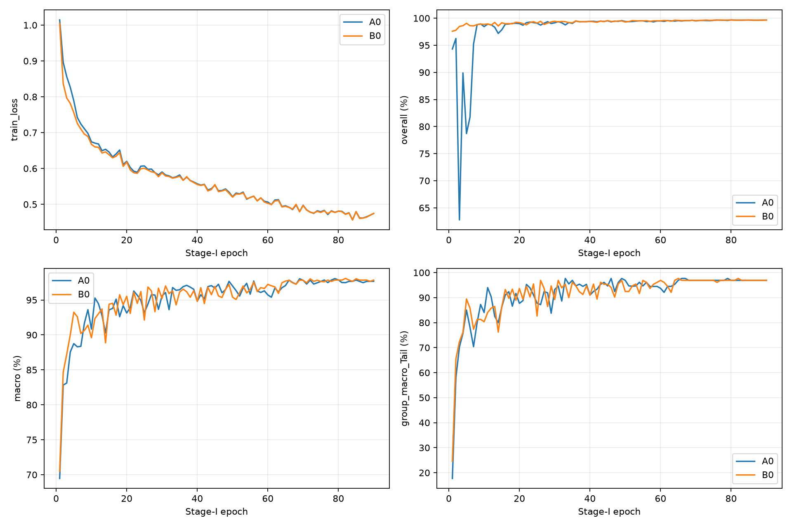
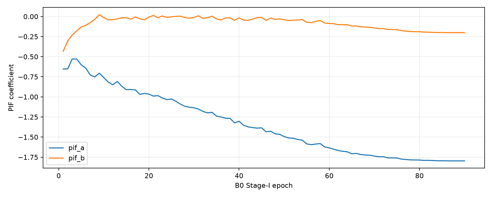
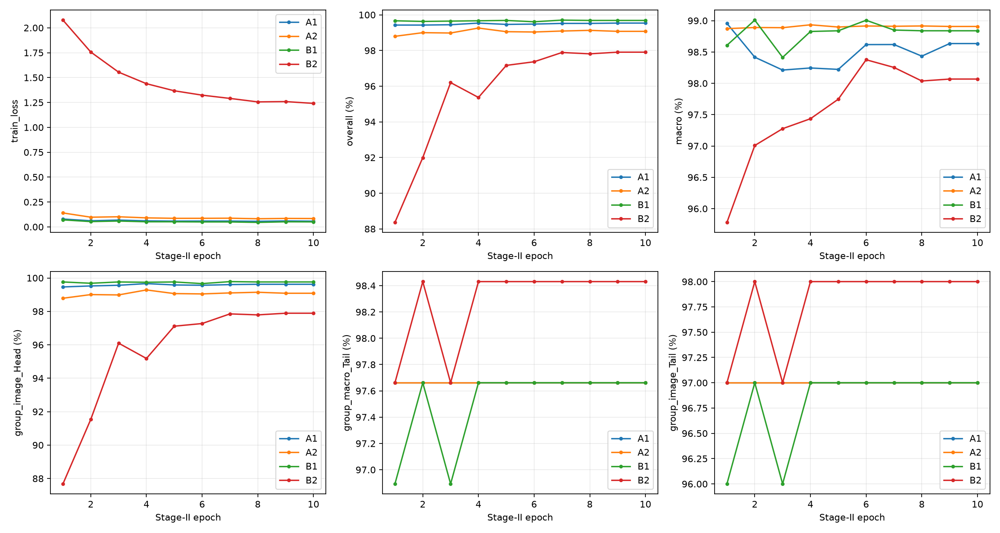
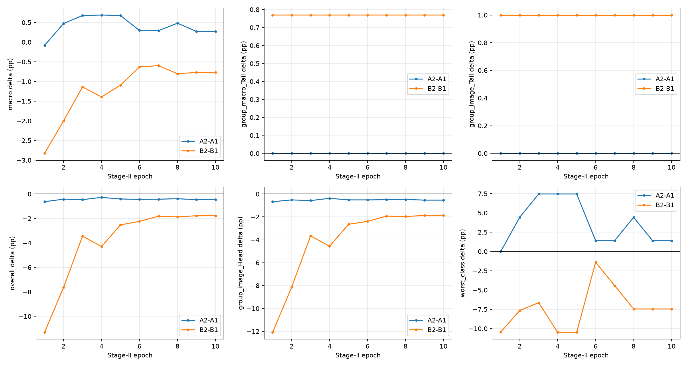
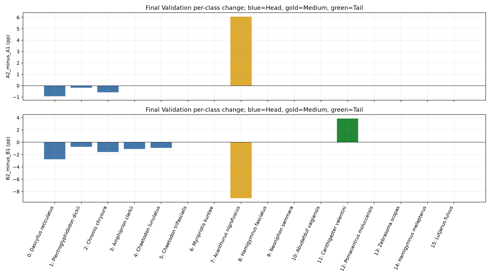
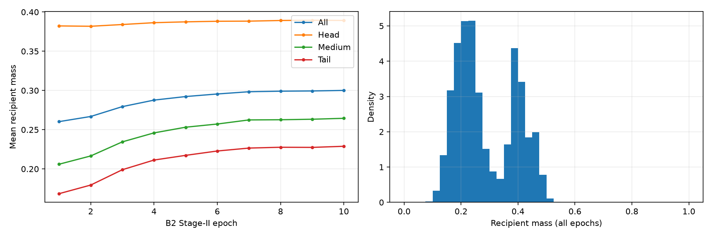

# Fish16 Seed-42 正式六组实验科学分析

日期：2026-11-05。全部数值为 **Validation**，准确率单位为 %，差值单位为百分点（pp）。

本轮完整完成 A0/B0 各 90 Epoch，A1/A2/B1/B2 各 10 Epoch。实际 223,740 次 SGD 调用、223,740 次梯度审计，0 跳步、0 日志 NaN/Inf；TEST 评价 0，额外 seed 0。正式进程退出码 0，开始于 2026-11-04 14:20:20，结束于 2026-11-05 01:51:44（Asia/Shanghai），墙钟 11.523 小时。

**主要科学发现：H2T 在 Macro/最差类上出现小幅正向权衡，但没有额外尾类收益；PI-H2TF 在本轮出现持续的 Head/Medium 损失，仅有极小的尾类净收益。PIF 的早期优势未转化为末轮尾类准确率优势。具体负迁移根因仍未证实。**

## 1. 协议与证据边界

唯一分支为 experiment/fish16-clean-launch-fix-20261103，执行 HEAD 为 072d7b77e0b77b8ca0187064519f5665f6422d0e。源自用户本轮任务的[完整规范](TASK_SPEC.txt)。没有改动六个正式运行器源码或八个锁定上游文件，没有重跑 Smoke、CPU 单元测试或 Preflight；复用已通过的 14 文件语法检查、41 个 CPU 测试及真实数据预检，按实际源码 SHA 判断有效性。HEAD 960b1be → 072d7b77 仅为既有 Smoke 归档，不影响源码一致性。

TRAIN 16,269 图像 / 5,208 groups；VAL 5,396 / 1,736 groups。类别按锁定训练频次分组，Head/Medium/Tail 为 6/5/5 类，训练图像为 15,231/737/301，验证图像为 **5,023/273/100**。因此 Overall 主要由 Head 决定，Macro、Tail macro 和 Tail image 必须并列解释。尾类每类验证仅 9–26 张、3–16 groups；视频轨迹内图像并非独立重复。类别及 group 数见 [CLASS_COVERAGE.csv](analysis/CLASS_COVERAGE.csv)。没有访问 TEST 图像路径、字节、Dataset 或 DataLoader。

A0/B0 从同一官方 resnet50-19c8e357.pth 初始化，backbone/head 初始化哈希相同。A1/A2 严格共用 A0 最终 Epoch 90，B1/B2 共用 B0 最终 Epoch 90。没有使用 Smoke、旧 FP16 部分训练或 best-validation 权重作为 Stage-II 来源。A0/B0 的全部 90 轮 recipient/MixUp 哈希相同；四个 Stage-II 条件每轮、每批 recipient 图像和标签哈希相同；A2/B2 donor 图像哈希相同。

全部 FP32，autocast=False，disabled GradScaler 的日志 Scale 恒为 1。Micro/effective batch=16，accumulation=1，seed=42，SGD momentum=0.9；Stage-I WD=1e-4、MixUp alpha=1；Stage-II WD=5e-4、普通 CE。原定 warmup/cosine LR 全部逐轮匹配，包括 Stage-I 最后一轮 LR=0；真实 optimizer.step 调用计数不等于该轮参数必然发生变化。A2 保留 rho=0.25；B2 保留 paper_theoretical_bounds、ratio_detach=True、当前 classifier.weight。

**本轮 Stage-II 冻结全部 extractor、BN 参数与 buffers，区别于任务指出的原始 H2T shift_bn=True 设置。** 四组末轮 extractor 与来源 checkpoint 逐张量精确相同；运行器还在每轮保存前检查完整状态，共通过 40 个运行时门禁。见[冻结表](analysis/EXTRACTOR_FREEZE_CHECKS.csv)和[源码门禁](https://github.com/LuoQiuXu/xin/blob/072d7b77e0b77b8ca0187064519f5665f6422d0e/H2T_repro_audit/cross_domain_failure_boundary/fish16_h2t_pih2t/formal_train.py#L696)。本地 PI_H2T_review 是锁定的独立重建实现；PIF 的 Conv1d 默认初始化被源码明确标为本地选择，不能视为恢复的作者初始化。[PIF 源码](https://github.com/LuoQiuXu/xin/blob/072d7b77e0b77b8ca0187064519f5665f6422d0e/PI_H2T_review/H2T-main/models/resnet_cifar.py#L159) 因此，本报告不把观察到的负迁移直接称为已发表 PI-H2T 方法的已证缺陷。

## 2. 正式末轮主结果

Stage-I 使用 Epoch 90；Stage-II 使用 Epoch 10。不得以 A2−B2 解释独立方法效果。

| 条件 | Epoch | Macro | Tail macro | Tail image | Overall | Head image | Medium image | Worst class |
|---|---|---|---|---|---|---|---|---|
| A0 | 90 | 97.6717 | 96.8923 | 96.0000 | 99.6664 | 99.8606 | 97.4359 | 78.7879 |
| B0 | 90 | 97.8405 | 96.8923 | 96.0000 | 99.6479 | 99.8208 | 97.8022 | 81.8182 |
| A1 | 10 | 98.6345 | 97.6615 | 97.0000 | 99.5367 | 99.6217 | 98.9011 | 90.9091 |
| A2 | 10 | 98.9073 | 97.6615 | 97.0000 | 99.0734 | 99.0842 | 99.6337 | 92.3077 |
| B1 | 10 | 98.8386 | 97.6615 | 97.0000 | 99.6850 | 99.7611 | 99.2674 | 92.3077 |
| B2 | 10 | 98.0679 | 98.4308 | 98.0000 | 97.9059 | 97.8897 | 98.1685 | 84.8485 |

同一表中 Head/Medium/Tail 的 image accuracy 是组内按图像加权；macro 是组内类别等权。以下补齐全部 group macro：

| 条件 | 末轮 Head macro | 末轮 Medium macro | 末轮 Tail macro | Best Head macro | Best Medium macro | Best Tail macro |
|---|---|---|---|---|---|---|
| A0 | 99.9162 | 95.7576 | 96.8923 | 99.9031 | 96.3636 | 96.8923 |
| B0 | 99.8615 | 96.3636 | 96.8923 | 99.8686 | 96.3636 | 96.8923 |
| A1 | 99.8226 | 98.1818 | 97.6615 | 99.7932 | 96.9697 | 97.6615 |
| A2 | 99.5400 | 99.3939 | 97.6615 | 99.6105 | 99.3939 | 97.6615 |
| B1 | 99.8616 | 98.7879 | 97.6615 | 99.8921 | 98.7879 | 97.6615 |
| B2 | 98.6807 | 96.9697 | 98.4308 | 98.6807 | 96.9697 | 98.4308 |

正式 Stage-II 配对增量：

| 比较 | ΔMacro | ΔTail macro | ΔTail image | ΔOverall | ΔHead image | ΔMedium image | ΔWorst |
|---|---|---|---|---|---|---|---|
| A2-A1 | +0.2728 | +0.0000 | +0.0000 | -0.4633 | -0.5375 | +0.7326 | +1.3986 |
| B2-B1 | -0.7707 | +0.7692 | +1.0000 | -1.7791 | -1.8714 | -1.0989 | -7.4592 |

完整精度保留于 [FINAL_VALIDATION.csv](analysis/FINAL_VALIDATION.csv)；220 轮完整记录见 [EPOCH_METRICS_ALL.csv](analysis/EPOCH_METRICS_ALL.csv)。

## 3. Stage-I：PIF 早期优势与收敛

首轮 A0/B0 Overall 为 94.3106/97.5908，Macro 为 69.4645/70.5113，Tail image 为 23/32，Tail macro 为 17.6923/24.6154；正式首轮重现了早期优势。到第 90 轮，B0−A0 变为 Overall −0.0185、Macro +0.1689、Tail macro 0、Tail image 0、Worst class +3.0303 pp。

逐类末轮改善仅发生在 Medium 的 Acanthurus nigrofuscus（78.7879→81.8182，33 张验证图像正确数净增 1），同时两类 Head 略降；五个 Tail 类末轮准确率全部一致。B1/A1 的 Tail 指标也一致。**没有证据表明 PIF 在本轮末轮改善尾类表征；准确率不是表征质量的直接测量，不能据此宣称表征机制已被证明。**

A0/B0 train MixUp loss 从 1.01455/1.00477 降至 0.47447/0.47469，晚期总体准确率接近稳定。按 Overall 选出的最佳轮分别为 A0:80、B0:77，末轮与各自最佳仅差约 0.0185 pp；当前曲线没有支持严重末期退化。验证损失和训练原图准确率未保存，不能完成严格的过拟合判定或比较 MixUp loss 与 Stage-II CE 的绝对高低。

PIF 的 a,b 对应 a·(F−channel_mean(F))+b·F。首轮后系数为 −0.652875/−0.433397，末轮为 −1.796361/−0.200663；全部 90 轮见指标 CSV。这里的首轮值不是初始化值。系数持续变化不等于性能持续改善，负系数本身也不是数值失败证据。

## 4. Stage-II：配对效应及持续性

**H2T（A2−A1）**：末轮 Macro +0.2728，Worst class +1.3986，Medium image +0.7326；Overall −0.4633，Head image −0.5375，Tail macro/image 均为 0。10 轮中 Overall 和 Head image 全部低于对应 cRT；Macro 第 1 轮略低，后 9 轮高于 cRT。全部 10 轮 Tail 指标与 A1 相同。正向收益集中在 Medium 的 Acanthurus nigrofuscus（90.9091→96.9697，正确数净增 2）；Head 的 Dascyllus reticulatus、Plectroglyphidodon dickii、Chromis chrysura 分别净减 22/1/4 张。合计 Head −27、Medium +2、Tail 0，Overall 正确数净减 25。

**PI-H2TF（B2−B1）**：末轮 Macro −0.7707，Overall −1.7791，Worst class −7.4592；Head image −1.8714、Medium image −1.0989；Tail macro +0.7692、Tail image +1.0000。10 轮 Macro、Overall、Head image 和 Medium image 全部低于对应 cRT；总体差距从首轮 −11.3047 缩至末轮 −1.7791，但没有转正。Tail image 相对 B1 每轮均为 +1 pp。

末轮 B2 的 Head 净减 94 张，主要为 Dascyllus reticulatus −65、Chromis chrysura −11、Amphiprion clarkii −9，其余 Plectroglyphidodon dickii −4、Chaetodon lunulatus −5；Medium 的 Acanthurus nigrofuscus 净减 3。Tail 的 Canthigaster valentini 从 92.3077→96.1538（26 张中正确数净增 1），其余四个 Tail 类准确率相同。**尾类总收益仅为 100 张验证图像中的正确数净增 1；没有逐样本预测记录，不能断言只有一张图像发生了预测翻转，也不能确定误判流向。** Overall 正确数合计净减 96。

每个类别的完整末轮准确率及配对变化：

| ID / species | 组 | VAL n | A1 | A2 | ΔH2T | B1 | B2 | ΔPI |
|---|---|---|---|---|---|---|---|---|
| 0 / Dascyllus reticulatus | Head | 2365 | 99.323 | 98.393 | -0.930 | 99.619 | 96.871 | -2.748 |
| 1 / Plectroglyphidodon dickii | Head | 547 | 100.000 | 99.817 | -0.183 | 99.817 | 99.086 | -0.731 |
| 2 / Chromis chrysura | Head | 687 | 99.854 | 99.272 | -0.582 | 99.854 | 98.253 | -1.601 |
| 3 / Amphiprion clarkii | Head | 825 | 99.758 | 99.758 | 0.000 | 99.879 | 98.788 | -1.091 |
| 4 / Chaetodon lunulatus | Head | 547 | 100.000 | 100.000 | 0.000 | 100.000 | 99.086 | -0.914 |
| 5 / Chaetodon trifascialis | Tail | 26 | 100.000 | 100.000 | 0.000 | 100.000 | 100.000 | 0.000 |
| 6 / Myripristis kuntee | Medium | 125 | 100.000 | 100.000 | 0.000 | 100.000 | 100.000 | 0.000 |
| 7 / Acanthurus nigrofuscus | Medium | 33 | 90.909 | 96.970 | 6.061 | 93.939 | 84.848 | -9.091 |
| 8 / Hemigymnus fasciatus | Medium | 46 | 100.000 | 100.000 | 0.000 | 100.000 | 100.000 | 0.000 |
| 9 / Neoniphon sammara | Head | 52 | 100.000 | 100.000 | 0.000 | 100.000 | 100.000 | 0.000 |
| 10 / Abudefduf vaigiensis | Tail | 14 | 100.000 | 100.000 | 0.000 | 100.000 | 100.000 | 0.000 |
| 11 / Canthigaster valentini | Tail | 26 | 92.308 | 92.308 | 0.000 | 92.308 | 96.154 | 3.846 |
| 12 / Pomacentrus moluccensis | Medium | 39 | 100.000 | 100.000 | 0.000 | 100.000 | 100.000 | 0.000 |
| 13 / Zebrasoma scopas | Tail | 25 | 96.000 | 96.000 | 0.000 | 96.000 | 96.000 | 0.000 |
| 14 / Hemigymnus melapterus | Tail | 9 | 100.000 | 100.000 | 0.000 | 100.000 | 100.000 | 0.000 |
| 15 / Lutjanus fulvus | Medium | 30 | 100.000 | 100.000 | 0.000 | 100.000 | 100.000 | 0.000 |

对应[逐类表](analysis/PER_CLASS_FINAL.csv)、[正确数净变化](analysis/PER_CLASS_NET_CORRECT_COUNTS.csv)和[每轮配对增量](analysis/PAIRWISE_EPOCH_EFFECTS.csv)均可复核。组正确数为聚合净变化，不是逐样本 McNemar 配对计数。

## 5. Best-validation 补充结果

每组只按预先固定的 Validation Overall 选 checkpoint，相同值取较早轮。此处报告同一个被选 checkpoint 的完整指标向量，不逐指标挑选最有利的轮次。其余 group macro 已在第 2 节并列补齐；全部字段见 [BEST_VALIDATION.csv](analysis/BEST_VALIDATION.csv)。

| 条件 | Epoch | Macro | Tail macro | Tail image | Overall | Head image | Medium image | Worst class |
|---|---|---|---|---|---|---|---|---|
| A0 | 80 | 97.8561 | 96.8923 | 96.0000 | 99.6850 | 99.8606 | 97.8022 | 81.8182 |
| B0 | 77 | 97.8432 | 96.8923 | 96.0000 | 99.6664 | 99.8407 | 97.8022 | 81.8182 |
| A1 | 4 | 98.2447 | 97.6615 | 97.0000 | 99.5367 | 99.6616 | 98.1685 | 84.8485 |
| A2 | 4 | 98.9338 | 97.6615 | 97.0000 | 99.2587 | 99.2833 | 99.6337 | 92.3077 |
| B1 | 7 | 98.8500 | 97.6615 | 97.0000 | 99.7035 | 99.7810 | 99.2674 | 92.3077 |
| B2 | 9 | 98.0679 | 98.4308 | 98.0000 | 97.9059 | 97.8897 | 98.1685 | 84.8485 |

A1 第 4 轮与末轮 Overall 相同而 Macro 更低，正说明不能把“best Overall”误称为“所有指标均最佳”。补充结果不替代固定 Epoch 10 的主比较，也没有用于 Stage-II 初始化。

## 6. 机制线索：事实、相关性与未验证因果

B2 在全部 162,690 个训练 recipient 记录中，recipient 系数 r 均值 0.287913，P05/median/P95=0.153107/0.251893/0.460625；donor 系数 1−r 均值 **0.712087**。99.6957% 的记录 donor 系数大于 0.5，49.1837% 大于 0.75。末轮 r 均值 0.300086；Head/Medium/Tail recipient 分别为 0.389267/0.264530/0.228863，Tail 对应 donor 系数均值 0.771137。r 来自当前 W 与 recipient 的余弦距离，保留原 [公式实现](https://github.com/LuoQiuXu/xin/blob/072d7b77e0b77b8ca0187064519f5665f6422d0e/PI_H2T_review/H2T-main/pi_h2t.py#L15)，未因结果而修改。

固定 donor 流每轮 Head/Medium/Tail 比例为 **93.8042% / 4.4256% / 1.7702%**；recipient 流为 37.4823%/31.1205%/31.3971%，与 6/5/5 类的按类均衡比例相符，不应把组比例不同误报为采样失配。同类 recipient-donor 仅 1,067/16,269=6.5585%，异类 93.4415%。这只是 species 标签关系，既不是 superclass/特征距离，也不能证明异类供体都不兼容。固定计划在 10 轮重复，增强视图逐轮变化；162,690 条记录不代表同等数量独立图像或独立实验。

A2 每批严格从 2,048 通道选 512 个，10,170 批共 5,207,040 次通道选择。每通道出现 2,395–2,686 次、均值 2,542.5，没有重复或越界通道。25% 是通道比例，不能直接当作 25% 特征能量，或与 PI-H2TF 的凸组合系数作能量等价比较。

| 候选解释 | 本轮可支持的事实 | 因果判断 |
|---|---|---|
| 供体贡献过强 | PI donor 系数均值 0.712，供体频次高度偏 Head | 系数层面的 donor 主导已记录；未测范数/能量贡献，不能证明“过强”导致损失 |
| 语义不匹配 | 93.44% recipient-donor 异类；负迁移集中于部分 Head 与一个 Medium 类 | 语义距离及兼容性没有测量；UNVERIFIED |
| 融合训练与原始特征推理的分布差异 | A2/B2 训练用融合特征，保存的 VAL 评价只用原始 recipient 特征 | 实现路径差异已确认；没有融合/原始特征的配对距离、margin 或误判流向，原因未证实 |
| Head/Tail 影响不对称 | B2 Head −94、Medium −3、Tail +1 的末轮正确数净变化；10 轮趋势一致 | 本 seed、此协议的描述性事实；不能推广为普遍机制 |
| AMP、BN 漂移或错误 checkpoint | 全 FP32，0 非有限/跳步；extractor/BN 精确冻结；来源 SHA 配对通过 | 本轮没有这些运行故障的证据，不用历史 FP16 失败解释当前结果 |

B2 train CE 从 2.07739 降至 1.24080，B1 从 0.07064 降至 0.05049；A2 从 0.14015 降至 0.08407，A1 从 0.07901 降至 0.05742。B2 的训练目标持续改善而原图 VAL 仍低于 cRT，是值得研究的分离现象。不同训练输入的 loss 不构成同分布拟合优劣的直接证明，也没有 VAL loss 支持“过拟合”定论。

证据：[PI 系数统计](analysis/PI_RECIPIENT_MASS_STATS.csv)、[供体类别频次](analysis/DONOR_RECIPIENT_FREQUENCY.csv)、[供受体类别配对](analysis/DONOR_RECIPIENT_CLASS_PAIRS.csv)、[H2T 通道计数](analysis/H2T_CHANNEL_COUNTS.csv)。

## 7. 六个科学问题的回答

1. **H2T 是否正向迁移？** 有限、依赖指标：Medium 和 Macro/最差类改善，Head/Overall 下降，Tail 无增益。不能概括为全面有效或全面失效。
2. **PI-H2TF 相比 cRT 有实际收益？** 本轮只有很小的尾类净收益，未带来 Macro/Overall/Worst 的综合收益，并伴随持续 Head/Medium 损失。
3. **PIF Stage-I 是否改善尾类表示？** 本轮末轮五个 Tail 类准确率完全相同，不支持该结论；表征质量本身未被直接测量。
4. **负迁移主要在哪些类？** H2T 为三个 Head 类；PI-H2TF 为五个 Head 类和 Medium 的 Acanthurus nigrofuscus。最大的总体损失来自 Dascyllus reticulatus。
5. **是否足以继续改进方法？** 足以提出一个针对观察现象的可证伪机制问题；不足以宣称普遍缺陷、已找到根因或已有改进必要性。单 seed、Validation-only、16-class subset、小尾类样本、冻结 BN、独立重建实现共同限制外推。
6. **下一轮唯一假设（本轮不执行）：** 在同一冻结 B0 表征下，B2 相对 B1 的 Head 负迁移与“融合训练特征到原始推理特征的真实类 margin 落差”有关。最小只读验证可锁定现有 B0/B1/B2 checkpoint，对同一组 VAL recipient、TRAIN donor 和预先固定的 B2 比例流，比较两分类头在相同融合/原始特征上的 margin 与逐样本预测。若 B2 没有更大的融合→原始 margin 落差，或落差不对应退化类，则该假设不受支持。该验证也不能单独证明训练因果主导性；不引入新模块、不训练、不用 TEST。本轮没有执行它。

**仍未解决：** 未保存逐样本预测频次/混淆矩阵，无法判断是否“只是预测分布改变”；没有特征距离、范数能量或 margin 证据；没有跨 seed/独立数据域重复；作者完整协议一致性不由本轮重新认证。所有这些保持未确定，不以相关性替代因果。

## 8. 可复核产物

完整原始运行、checkpoint 与控制台日志继续保存在 D:\h2t_cross_domain_results\fish16_formal_seed42_90x10_20261104_01 及其同前缀 console.log。此 Git 归档只包含小体积报告、指标、SHA 证据和 CPU 统计脚本；没有图片、checkpoint、NPZ 或逐 batch 原始日志。

[执行状态](raw/ACTUAL_EXECUTION_STATUS.json)、[运行协议](raw/FORMAL_RUN_MANIFEST.json)、[运行器原始 SHA 清单](raw/OUTPUT_SHA256.csv)、[checkpoint 来源及 SHA](analysis/CHECKPOINT_SHA256.csv)、[独立 CPU 核验](analysis/POSTRUN_VALIDATION.json)、[验证说明](VALIDATION_REPORT.md)。曲线同时提供 PNG 与 PDF，均由保存指标通过 Matplotlib 生成，没有新增 GPU 推理。
