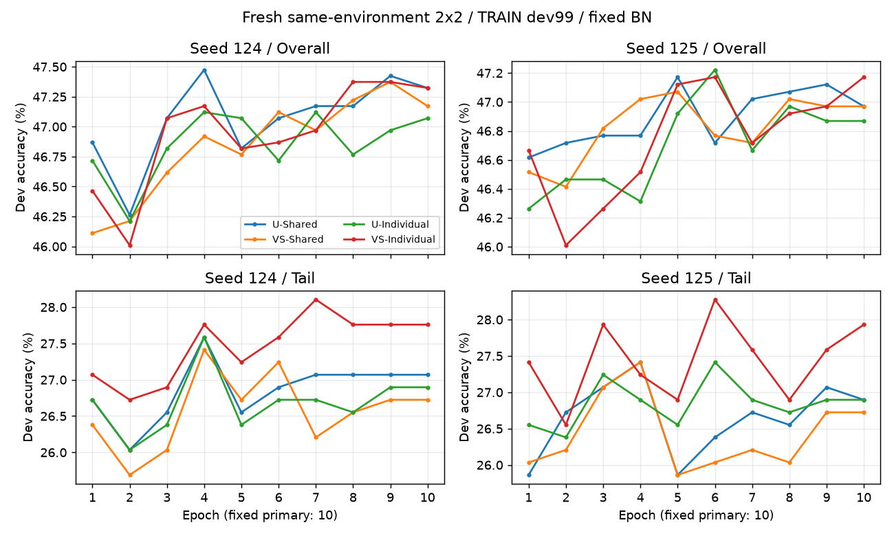

# Low-VS same-environment 2x2 scientific report

This report is mechanically generated from **eight newly trained arms**; no historical
accuracy is reused as a contemporary arm. All outcomes are on the repeatedly used
**TRAIN-held-out 99-class development split (1980 images, class 0 absent)**,
not on the official TEST set. Results are exploratory, NOT statistically independent
confirmation of a new method.

## Fixed epoch 10, percent (%)

| Seed | Arm | Overall | Head | Medium-ID | Tail | Few |
|---|---|---:|---:|---:|---:|---:|
|124|U-Shared|47.3232|60.2857|51.1429|27.0690|27.6667|
|124|VS-Shared|47.1717|61.4286|49.8571|26.7241|27.1667|
|124|U-Individual|47.0707|60.1429|50.7143|26.8966|27.5000|
|124|VS-Individual|47.3232|59.8571|51.0000|27.7586|28.3333|
|125|U-Shared|46.9697|59.8571|50.7143|26.8966|27.5000|
|125|VS-Shared|46.9697|60.5714|50.1429|26.7241|27.1667|
|125|U-Individual|46.8687|60.1429|50.1429|26.8966|27.5000|
|125|VS-Individual|47.1717|59.5714|50.7143|27.9310|28.5000|

## Paired comparisons: positive delta means first method wins

| Seed | Comparison | Group | delta pp | net correct |
|---|---|---|---:|---:|
|124|VS-Shared - U-Shared|Overall|-0.1515|-3|
|124|VS-Shared - U-Shared|Tail|-0.3448|-2|
|124|VS-Individual - U-Individual|Overall|+0.2525|+5|
|124|VS-Individual - U-Individual|Tail|+0.8621|+5|
|124|U-Individual - U-Shared|Overall|-0.2525|-5|
|124|U-Individual - U-Shared|Tail|-0.1724|-1|
|124|VS-Individual - VS-Shared|Overall|+0.1515|+3|
|124|VS-Individual - VS-Shared|Tail|+1.0345|+6|
|124|VS-Individual - U-Shared|Overall|+0.0000|+0|
|124|VS-Individual - U-Shared|Tail|+0.6897|+4|
|125|VS-Shared - U-Shared|Overall|+0.0000|+0|
|125|VS-Shared - U-Shared|Tail|-0.1724|-1|
|125|VS-Individual - U-Individual|Overall|+0.3030|+6|
|125|VS-Individual - U-Individual|Tail|+1.0345|+6|
|125|U-Individual - U-Shared|Overall|-0.1010|-2|
|125|U-Individual - U-Shared|Tail|+0.0000|+0|
|125|VS-Individual - VS-Shared|Overall|+0.2020|+4|
|125|VS-Individual - VS-Shared|Tail|+1.2069|+7|
|125|VS-Individual - U-Shared|Overall|+0.2020|+4|
|125|VS-Individual - U-Shared|Tail|+1.0345|+6|

## Predefined decision: NO_GO_FOR_PREREGISTERED_SCREEN

This only decides whether independent confirmation is worth running, not publication readiness.

## Interpretation rules

Primary: same-granularity VS-Shared vs U-Shared and VS-Individual vs U-Individual.
Secondary: VS-Individual vs U-Shared is a **confounded** replacement comparison.
Only fixed epoch10 is confirmatory *within this exploratory screen*. Best validation
epoch is descriptive. No official-test or independent-data benefit can be claimed.
Shared score aggregation differs from individual scores, so the numeric interaction
also contains scoring-aggregation effects, not just mask-sharing effects.
No parameter tuning, no new seeds, no new channel candidate count.

Suggested provisional GO only if both within-granularity VS controls improve Tail
by >=0.5 pp in BOTH seeds and have nonnegative Overall in BOTH seeds; even a GO
requires a genuinely independent follow-up split / new Stage I / unseen dataset.
Otherwise: NO-GO for blanket superiority or INCONCLUSIVE for an ambiguous tradeoff.

## Source data

`epoch10.csv`, `paired_contrasts.csv`, `per_class_contrasts.csv`,
`interactions.csv`, and each run's `batch_signatures.csv`,
`actual_masks.npz`, `summary.json`, and saved classification head.


## 严格配对与数据完整性（本轮新证据）

执行解释器 `D:\app\minicondaaa\envs\xiaoju\python.exe`；torch `2.14.1+cu132`；CUDA `13.2`。
八臂全部在同一环境从同一Clean epoch184初始化。四臂模型均为新训练，没有载入旧Stage-II模型或把旧准确率充当本次对照。
13字段=epoch/batch/size三项与十个哈希。每个seed其余三臂相对本轮U-Shared，每项850/850完全一致；无数值环境豁免。
真实原始TRAIN像素、标签、官方seed0的LT索引、1980张留出索引与不重叠检查通过。每类20，class0缺失，保留100维输出。
历史锁定文件/报告74项前后SHA不变；官方TEST访问事件0，历史写入事件0。
所有Backbone参数、BN affine及running_mean/running_var/counter逐位固定；只更新6500个FC参数。best/final均独立加载后逐项验证指标，final logits/predictions逐位复核。

## 主门槛逐项判定

|seed|主比较|ΔTail pp|Tail净张数|ΔOverall pp|Overall净张数|ΔHead pp|ΔFew pp|通过|
|---|---|---:|---:|---:|---:|---:|---:|---|
|124|VS-Shared - U-Shared|-0.3448|-2|-0.1515|-3|+1.1429|-0.5000|False|
|124|VS-Individual - U-Individual|+0.8621|+5|+0.2525|+5|-0.2857|+0.8333|True|
|125|VS-Shared - U-Shared|-0.1724|-1|+0.0000|+0|+0.7143|-0.3333|False|
|125|VS-Individual - U-Individual|+1.0345|+6|+0.3030|+6|-0.5714|+1.0000|True|

原0.5pp与Overall非负阈值原样保留。未全满足时判为本次预注册screen的NO-GO；若方向分歧/组间权衡，保留不确定性，不将NO-GO解释为证明所有设置均无效。
一张图=0.050505pp Overall、0.142857pp Head、0.172414pp Tail、0.166667pp Few。n=2不做p值，两个seed使用同一1980张图，不能将3960次预测当独立样本。

## 全部逐图配对得失（真实类别正确性）

|seed|比较|组|wrong→right|right→wrong|净张数|Δpp|
|---|---|---|---:|---:|---:|---:|
|124|VS-Shared - U-Shared|Overall|15|18|-3|-0.1515|
|124|VS-Shared - U-Shared|Head|10|2|+8|+1.1429|
|124|VS-Shared - U-Shared|OfficialMedium|2|11|-9|-1.2857|
|124|VS-Shared - U-Shared|Tail|3|5|-2|-0.3448|
|124|VS-Shared - U-Shared|Few|3|6|-3|-0.5000|
|124|VS-Individual - U-Individual|Overall|18|13|+5|+0.2525|
|124|VS-Individual - U-Individual|Head|2|4|-2|-0.2857|
|124|VS-Individual - U-Individual|OfficialMedium|11|9|+2|+0.2857|
|124|VS-Individual - U-Individual|Tail|5|0|+5|+0.8621|
|124|VS-Individual - U-Individual|Few|5|0|+5|+0.8333|
|124|U-Individual - U-Shared|Overall|7|12|-5|-0.2525|
|124|U-Individual - U-Shared|Head|1|2|-1|-0.1429|
|124|U-Individual - U-Shared|OfficialMedium|5|8|-3|-0.4286|
|124|U-Individual - U-Shared|Tail|1|2|-1|-0.1724|
|124|U-Individual - U-Shared|Few|1|2|-1|-0.1667|
|124|VS-Individual - VS-Shared|Overall|28|25|+3|+0.1515|
|124|VS-Individual - VS-Shared|Head|1|12|-11|-1.5714|
|124|VS-Individual - VS-Shared|OfficialMedium|18|10|+8|+1.1429|
|124|VS-Individual - VS-Shared|Tail|9|3|+6|+1.0345|
|124|VS-Individual - VS-Shared|Few|10|3|+7|+1.1667|
|124|VS-Individual - U-Shared|Overall|16|16|+0|+0.0000|
|124|VS-Individual - U-Shared|Head|2|5|-3|-0.4286|
|124|VS-Individual - U-Shared|OfficialMedium|9|10|-1|-0.1429|
|124|VS-Individual - U-Shared|Tail|5|1|+4|+0.6897|
|124|VS-Individual - U-Shared|Few|5|1|+4|+0.6667|
|125|VS-Shared - U-Shared|Overall|14|14|+0|+0.0000|
|125|VS-Shared - U-Shared|Head|5|0|+5|+0.7143|
|125|VS-Shared - U-Shared|OfficialMedium|6|10|-4|-0.5714|
|125|VS-Shared - U-Shared|Tail|3|4|-1|-0.1724|
|125|VS-Shared - U-Shared|Few|3|5|-2|-0.3333|
|125|VS-Individual - U-Individual|Overall|18|12|+6|+0.3030|
|125|VS-Individual - U-Individual|Head|1|5|-4|-0.5714|
|125|VS-Individual - U-Individual|OfficialMedium|10|6|+4|+0.5714|
|125|VS-Individual - U-Individual|Tail|7|1|+6|+1.0345|
|125|VS-Individual - U-Individual|Few|7|1|+6|+1.0000|
|125|U-Individual - U-Shared|Overall|8|10|-2|-0.1010|
|125|U-Individual - U-Shared|Head|3|1|+2|+0.2857|
|125|U-Individual - U-Shared|OfficialMedium|2|6|-4|-0.5714|
|125|U-Individual - U-Shared|Tail|3|3|+0|+0.0000|
|125|U-Individual - U-Shared|Few|3|3|+0|+0.0000|
|125|VS-Individual - VS-Shared|Overall|25|21|+4|+0.2020|
|125|VS-Individual - VS-Shared|Head|1|8|-7|-1.0000|
|125|VS-Individual - VS-Shared|OfficialMedium|14|10|+4|+0.5714|
|125|VS-Individual - VS-Shared|Tail|10|3|+7|+1.2069|
|125|VS-Individual - VS-Shared|Few|11|3|+8|+1.3333|
|125|VS-Individual - U-Shared|Overall|16|12|+4|+0.2020|
|125|VS-Individual - U-Shared|Head|2|4|-2|-0.2857|
|125|VS-Individual - U-Shared|OfficialMedium|7|7|+0|+0.0000|
|125|VS-Individual - U-Shared|Tail|7|1|+6|+1.0345|
|125|VS-Individual - U-Shared|Few|7|1|+6|+1.0000|

以上按真实label是否正确统计；错误预测从一个组转向另一个错误组不计收益。每类净变化和Δpp完整保存在per_class_contrasts.csv。

## 实际掩码与迁移统计组成

|seed|臂|相同粒度Uniform下改变掩码draw数|平均重合通道|不同通道组合|V均值|B均值|逐样本ratio均值|
|---|---|---:|---:|---:|---:|---:|---:|
|124|U-Shared|0/108470|16.0000|850|3.716430|10.132614|0.304459|
|124|VS-Shared|107958/108470|11.9802|850|3.619577|10.359788|0.292451|
|124|U-Individual|0/108470|16.0000|108470|3.717960|10.123446|0.304977|
|124|VS-Individual|104920/108470|12.1119|108470|3.823070|13.286583|0.249363|
|125|U-Shared|0/108470|16.0000|850|3.707591|10.058552|0.305593|
|125|VS-Shared|108086/108470|11.9885|850|3.616043|10.297421|0.293334|
|125|U-Individual|0/108470|16.0000|108470|3.715537|10.138770|0.304414|
|125|VS-Individual|104928/108470|12.1190|108470|3.821244|13.295131|0.249191|

V为正则化供体类内方差之和，B为供体类均值到接收GAP的平方偏移之和；ratio为每个draw的V/(V+B+epsilon)再取均值，不等于均值的比。
fallback_reason_counts记录原trace原因；Shared只排除无效评分参与批均值，并在全批无有效评分时Uniform回退。fallback未删供体或改变IS分布。
mask_diagnostics.csv保存64通道实际选中次数；mask_comparisons.csv保存五对比较的重合/相同/不同draw。Shared掩码在每批内完全相关，不把重复128次当128个独立掩码。

## 全10 epoch曲线、best诊断、耗时和显存



|seed|臂|epoch1 Overall/Tail|epoch10 Overall/Tail|best epoch / Overall|运行秒|训练秒|allocated/reserved MiB|
|---|---|---|---|---|---:|---:|---|
|124|U-Shared|46.8687/26.7241|47.3232/27.0690|4/47.4747|53.03|52.03|123.98/160.00|
|124|VS-Shared|46.1111/26.3793|47.1717/26.7241|9/47.3737|53.36|52.38|123.98/160.00|
|124|U-Individual|46.7172/26.7241|47.0707/26.8966|4/47.1212|53.74|52.75|123.98/160.00|
|124|VS-Individual|46.4646/27.0690|47.3232/27.7586|8/47.3737|52.89|51.87|123.98/160.00|
|125|U-Shared|46.6162/25.8621|46.9697/26.8966|5/47.1717|52.61|51.62|123.98/160.00|
|125|VS-Shared|46.5152/26.0345|46.9697/26.7241|5/47.0707|52.85|51.87|123.98/160.00|
|125|U-Individual|46.2626/26.5517|46.8687/26.8966|6/47.2222|53.49|52.45|123.98/160.00|
|125|VS-Individual|46.6667/27.4138|47.1717/27.9310|6/47.1717|52.75|51.72|123.98/160.00|

耗时包含相同审计、增强、前向与训练，运行秒还含保存/评估/重载核验；顺序运行受系统负载影响。allocated/reserved只统计PyTorch CUDA内存，不等于含驱动和桌面的总显存。
best按开发集Overall选择，仅作诊断，不替代固定epoch10主终点；epoch_curves.csv包含全部80行。

## 异常、工程修补与复现命令

执行前补齐原入口缺少的真实GPU preflight、通过门禁、冻结/环境/写保护证据、Few配对与报告字段。详见../BUGFIXES.md和../ENGINEERING_FIX.patch。
mask_policy.py、test_mask_policy.py、PROTOCOL.md、评分、Bottom48/16、rho、fallback、SGD/CE/cosine/epoch/seed均未改变；cuDNN数值设置沿用原helper，没有在失败后调参过关。
本次成功路径无FAILED_STOP.json；若发生任何失败会保留错误栈和当前输出并全局停止。完整stdout在console_*.txt，配对850行原始CSV、actual_masks.npz及模型只存本地，不纳入小型交付提交。
缓存验证特征属于明确复用的锁定输入，可能生成于历史软件环境；四臂完全共用它，不将缓存或历史结果当作新训练的模型对照。

```powershell
Set-Location 'D:\xiangmuxunlian\xin'
$py = 'D:\app\minicondaaa\envs\xiaoju\python.exe'
$entry = 'H2T_repro_audit/lowvs_mask_parity/run_parity.py'
& $py $entry unit
& $py $entry preflight
& $py $entry train --seed 124 --arm U-Shared
& $py $entry train --seed 124 --arm VS-Shared
& $py $entry train --seed 124 --arm U-Individual
& $py $entry train --seed 124 --arm VS-Individual
& $py $entry train --seed 125 --arm U-Shared
& $py $entry train --seed 125 --arm VS-Shared
& $py $entry train --seed 125 --arm U-Individual
& $py $entry train --seed 125 --arm VS-Individual
& $py $entry report
```

输出已存在时不可重跑以上命令；每条命令成功后才进入下一条。

## 结尾七项判断

1. **严格配对比较**：五对比较的全部13字段在同seed内均逐batch一致。主要因果对象限于同粒度VS对Uniform的训练干预。
2. **净得失**：见本报告逐图表；只有真实wrong→right减right→wrong计入净正确数，完整每类结果未挑选。
3. **原H2T代表性**：U-Shared保留随机16/64的边际分布、共享语义和完整通道复制；没有复刻官方torch.randperm路径，且BN冻结和dev99协议不同，不能称完整官方H2T复现。
4. **粒度混杂**：U-Individual−U-Shared是随机粒度比较；VS-Individual−VS-Shared另含评分聚合改变；VS-Individual−U-Shared为多因素，不是评分独立收益。交互项同样含聚合定义。
5. **开发集限制**：class0无样本、每类20图，历史反复用于Stage-I/方法开发，不是盲测，不与论文100类官方TEST准确率直接相减。
6. **支持力度**：只有一个Clean Backbone、两个Stage-II随机流、分类器训练与复用dev；即使通过筛选也不证明独立泛化或端到端表示改进。
7. **下一步决策**：NO_GO_FOR_PREREGISTERED_SCREEN。原预注册门槛以本报告四行主检查为准；方向/Head与Overall成本如实保留。不追加seed、策略或搜索。

**本轮6800次正式更新结束后停止，不训练Stage I，不访问官方TEST，不自行启动下一版方法。**