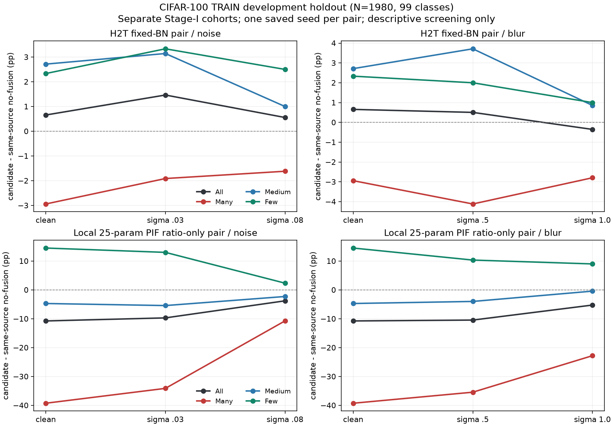
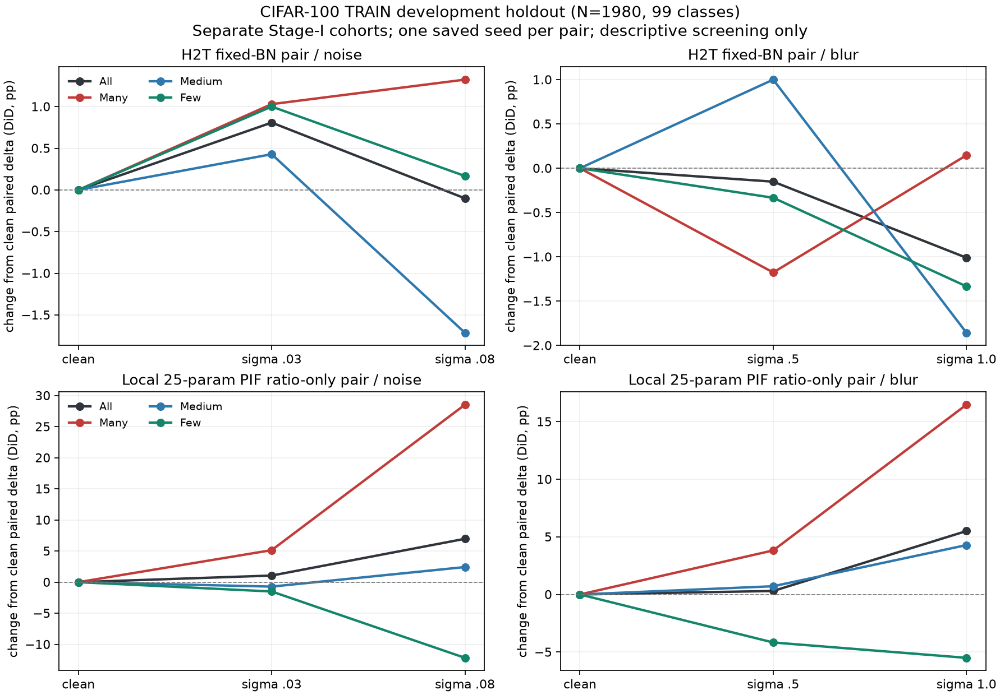

# H2T / 本地 PIF ratio-only 受控输入偏移筛查

日期：2026-10-28。唯一工作分支：`experiment/pi-h2t-failure-scenario-screen-20261028`；起始提交：`54160b7e450d37ae0c227ea616e25ba186d5905f`。完整任务为本目录上级的 `CODEX_PI_FAILURE_SCENARIO_SCREEN.txt`；本次完成真实推理，不只是静态或合成测试。

**科学决策：NO-GO（`NO_GO_FOR_NEW_RESEARCH_DIRECTION`）。** 已存的本地 25 参数 PIF ratio-only 原型在 Few 组出现跨两个强度一致的“相对同源 no-fusion 的 clean 优势被侵蚀”信号，分别通过噪声与模糊家族的预设筛查门槛。H2T fixed-BN 配对没有通过该门槛。该信号仅属于这些历史 checkpoint 和重复开发集；不等于作者完整 PI-H2T 失效，不构成已证实的新研究空白，也不授权新模块或训练。

## 可用 checkpoint 与合法配对

从 464 个本地权重路径（含历史保存副本）核验并选定以下四个 Stage-II 最终 epoch10 权重。完整路径、SHA256、Stage-I 来源、架构、预处理及选择集见 [可用性表](CHECKPOINT_AVAILABILITY.csv)、[逐张量配对核验](CHECKPOINT_AVAILABILITY.json)；实际源码行号及哈希见 [证据表](SOURCE_EVIDENCE.csv)。

|配对|模型|Stage-I best epoch / SHA前缀|Stage-II seed|最终权重SHA前缀|历史训练协议边界|
|---|---|---|---:|---|---|
|H2T|h2t_no_fusion|198 / 0cf3e67a|123|1b054d8b|ResNet32 Option-A，rho0，固定BN|
|H2T|h2t|198 / 0cf3e67a|123|29d28c4c|同源，rho.25，固定BN；不是完整作者BN-shift协议|
|本地PIF|pi_no_fusion|164 / a1b1630b|42|b1d38bce|保留25参数PIF，T2 donor scale0；历史双前向BN-shift|
|本地PIF|pi_local|164 / a1b1630b|42|a37e23a8|同源，T3 native ratio-only；历史双前向BN-shift|

四个 Stage-II 模型均可严格加载，100 类线性头含 bias。每个配对的全部可训练骨干/PIF参数均精确等于自身 Stage-I；最终完整骨干（包括 BN running_mean、running_var、num_batches_tracked）在配对内部逐张量相同，H2T 对照186个状态张量、本地PIF对照192个；仅最终分类头不同。没有人为重置或对齐 BN。两对 Stage-I 不同，PIF架构也不同，因此仅在各自配对内估计差值，不能把 H2T 和本地PIF的绝对准确率之差解释为融合机制的因果差异。

本地PIF准确使用旧的三层带bias Conv1d结构，共25参数；没有借用20261027重建的2参数 checkpoint。旧T3元数据缺少 `donor_mass_scale` 字段，原始 experiment、历史诊断及保留训练器默认值支持 native=1，但历史执行时完整 Git revision **UNVERIFIED**。本轮验证的是可加载权重的真实行为，而不是追认完整作者实现一致性。Stage-I 的旧 best 选择曾使用官方TEST，这一历史事实保留披露；本轮固定 Stage-II last epoch10，未依据本轮 clean/shift 指标选择 checkpoint，未读取官方TEST数据。

## 已固定的输入与评价协议

只读取原始 CIFAR-100 **TRAIN**，SHA256 `735e79b04f092ca3d2e6d07f368c0a7d70d48c48d28865950cc24454cf45129b`。根据两个历史源码的 seed0、IF=.01指数采样，独立重建10,847张LT训练索引，并逐项比对历史 split、全部训练/验证原始像素与标签。采用既有 `clean_vs_stability_runs/clean_s1_seed42_s2_124_125_20261014/split_indices.npz` 中固定1,980张 validation；与LT训练 raw IDs 交集0、原始像素SHA交集0。不调用会顺带打开TEST的旧数据集包装器。

这是**重复使用的开发holdout**，不是新的独立测试集。99个可观察类各20张，class0的500张TRAIN都已进入LT，holdout中无class0。输出仍为100维 logits；Macro和Worst-Class只计算99个实际观察类，不能宣称100类Worst-Class已验证。Macro≈Overall是每个观察类样本数相同的结果。

本轮按实际LT类频定义 Many>100、Medium20..100、Few<20，对应观察样本680/700/600；不是历史按ID分段的36/35/29组，所以不与旧报告的Head/Tail组数值直接对照。

五个条件固定为 clean、noise_003、noise_008、blur_05、blur_10。噪声在[0,1]原始像素域按 `SeedSequence([20261028, raw_id])` 产生，两个强度复用同一标准高斯方向，再分别乘.03/.08；裁剪并四舍五入到uint8。模糊使用显式3×3、sigma.5/1.0的分离高斯核与reflect padding，同样在 ToTensor/Normalize 前执行。固定预处理 mean=(.4914,.4822,.4465)、std=(.2023,.1994,.2010)。所有模型读取同一扰动缓存；每条件归一化输入哈希在四个模型间一致。

在推理前，从每个类频组随机预选3图，检查了9图×5条件的[视觉接触表](VISUAL_CORRUPTION_AUDIT.png)，未见需要整条件剔除的明显语义破坏，保留全部预设条件，没有挑选或删除单图。噪声.08有明显颗粒，blur1.0丢失细节；抽查不能保证全部1,980张都完全可辨。审查记录与预设门槛哈希见 [VISUAL_AUDIT.json](VISUAL_AUDIT.json)。

推理使用同一个RTX5070 Laptop 8GB，batch32，FP32；model/classifier均eval、requires_grad=False，inference_mode，无Dropout、autocast、optimizer或反向传播。cudnn benchmark=False、deterministic=True、TF32=False，matmul TF32=False、precision=highest，deterministic_algorithms=True，CUBLAS_WORKSPACE_CONFIG=:4096:8。PyTorch2.14.1+cu132、torchvision0.29.1+cu132、NumPy2.5.2、CUDA13.2、cuDNN92400。最大实际tensor allocated峰值约57.75MiB（不包括全部CUDA驱动/上下文占用）。

## Observed：真实推理结果

百分比保留4位，未用历史官方TEST分数替代本轮预测。四模型×五条件均生成 `(1980,100)` float32有限 logits；NPZ只有int64 ids/labels和float32 logits，无pickle。参数和BN在每条件前后哈希不变。

### H2T fixed-BN配对

|条件|已存模型|Overall %|Macro %|Many %|Medium %|Few %|Worst-Class %|
|---|---|---:|---:|---:|---:|---:|---:|
|clean|h2t_no_fusion|47.7778|47.7778|67.6471|48.5714|24.3333|0.0000|
|clean|h2t|48.4343|48.4343|64.7059|51.2857|26.6667|5.0000|
|noise_003|h2t_no_fusion|33.0303|33.0303|48.6765|34.0000|14.1667|0.0000|
|noise_003|h2t|34.4949|34.4949|46.7647|37.1429|17.5000|0.0000|
|noise_008|h2t_no_fusion|11.5657|11.5657|15.8824|11.4286|6.8333|0.0000|
|noise_008|h2t|12.1212|12.1212|14.2647|12.4286|9.3333|0.0000|
|blur_05|h2t_no_fusion|43.5859|43.5859|61.7647|44.8571|21.5000|0.0000|
|blur_05|h2t|44.0909|44.0909|57.6471|48.5714|23.5000|0.0000|
|blur_10|h2t_no_fusion|20.6566|20.6566|24.5588|24.7143|11.5000|0.0000|
|blur_10|h2t|20.3030|20.3030|21.7647|25.5714|12.5000|0.0000|

### 本地25参数PIF ratio-only配对

|条件|已存模型|Overall %|Macro %|Many %|Medium %|Few %|Worst-Class %|
|---|---|---:|---:|---:|---:|---:|---:|
|clean|pi_no_fusion|45.5556|45.5556|63.8235|49.7143|20.0000|0.0000|
|clean|pi_local|34.7980|34.7980|24.5588|45.0000|34.5000|0.0000|
|noise_003|pi_no_fusion|31.2626|31.2626|45.1471|33.5714|12.8333|0.0000|
|noise_003|pi_local|21.5657|21.5657|11.0294|28.1429|25.8333|0.0000|
|noise_008|pi_no_fusion|8.2828|8.2828|11.6176|5.2857|8.0000|0.0000|
|noise_008|pi_local|4.4949|4.4949|0.8824|3.0000|10.3333|0.0000|
|blur_05|pi_no_fusion|42.5758|42.5758|59.1176|45.8571|20.0000|0.0000|
|blur_05|pi_local|32.1212|32.1212|23.6765|41.8571|30.3333|0.0000|
|blur_10|pi_no_fusion|23.1313|23.1313|32.6471|24.1429|11.1667|0.0000|
|blur_10|pi_local|17.8788|17.8788|9.8529|23.7143|20.1667|0.0000|

### 配对差值及difference-in-differences

定义 Δ(condition)=candidate准确率−同源reference准确率；DiD=Δ(shift)−Δ(clean)。负值只表示相对clean的配对优势减少。每张图的DiD取值可为−2..2；`excess_net_correct`是其有符号求和，不等于简单转错图像数。完整同条件 wrong→right/right→wrong 分组计数见两组 `paired_contrasts.csv`，clean→shift各方法变化见 `shift_degradation.csv`，逐图正确性/DiD保留本地 `paired_image_changes.npz`。

H2T：

|条件|Overall DiD pp|Many DiD pp|Medium DiD pp|Few DiD pp|
|---|---:|---:|---:|---:|
|noise_003|+0.8081|+1.0294|+0.4286|+1.0000|
|noise_008|-0.1010|+1.3235|-1.7143|+0.1667|
|blur_05|-0.1515|-1.1765|+1.0000|-0.3333|
|blur_10|-1.0101|+0.1471|-1.8571|-1.3333|

本地PIF：

|条件|Overall DiD pp|Many DiD pp|Medium DiD pp|Few DiD pp|
|---|---:|---:|---:|---:|
|noise_003|+1.0606|+5.1471|-0.7143|-1.5000|
|noise_008|+6.9697|+28.5294|+2.4286|-12.1667|
|blur_05|+0.3030|+3.8235|+0.7143|-4.1667|
|blur_10|+5.5051|+16.4706|+4.2857|-5.5000|

本地PIF的Few逐图配对（N=600）：

|条件|reference对→candidate错|reference错→candidate对|同条件净增正确数|相对clean额外净正确数|负DiD图像数|
|---|---:|---:|---:|---:|---:|
|clean|9|96|87|0|0|
|noise_003|1|79|78|-9|62|
|noise_008|8|22|14|-73|96|
|blur_05|8|70|62|-25|58|
|blur_10|2|56|54|-33|77|

clean Few的+14.50pp净优势相当于+87张正确图像；噪声.03/.08时仍分别为+78/+14张，模糊.5/1.0时仍为+62/+54张。因此这里的“失效候选”是**优势侵蚀**，不是Few性能已低于no-fusion或全部类别同时受损。

### 固定筛查门槛及全部结果

`PRE_REGISTERED_SCREEN_RULES.json` 在真实模型前向前写入；其SHA256 `42c7baf0aeb261728944a72c6461ebd72ea2c34f399f18d96e809e9357412b92` 与视觉审查、推理运行记录中的哈希一致。将任务的“明显超过单图波动”事先操作化为：同一配对、同一类频组、同一预设扰动家族的**两个强度**都满足 DiD≤−0.5pp、额外净正确数≤−3、至少3张不同图像具有负DiD。类频特异性还要求两个强度该组DiD均比Overall DiD低至少.5pp。这些是描述性筛查阈值，不是显著性检验，也没有观察后调整。

全部16个pair×family×group检查见 [SCREEN_CANDIDATES.csv](SCREEN_CANDIDATES.csv)；12个为类频特异窗口，另4个为Overall。仅本地PIF Few的noise和blur两项通过。H2T Many在blur两强度符号反转；Medium也符号反转；Overall和Few虽在blur均负，但低强度不足事前效应门槛。因此H2T为 **inconclusive**，不能表述为已证明没有任何分布敏感性。没有追加扰动、强度、checkpoint或种子来获得GO。

## Interpretation：A / B / C / D

**A：clean已有头尾取舍吗，扰动是否放大？** H2T clean相对同源no-fusion为Overall+0.6566pp、Many−2.9412pp、Few+2.3333pp；本地PIF为Overall−10.7576pp、Many−39.2647pp、Few+14.50pp。本地原型的严重Many损失在clean已存在，不能归因于此次扰动；扰动后其Many负差反而收窄，Few优势却在两个家族均缩小。这里没有“整体头类问题被显著放大”的证据。可支持的仅是本地原型Few优势的跨强度侵蚀；“显著”仅按预设实际效应筛查理解，未完成训练种子层面的统计推断。

**B：所有方法都受噪声影响，还是相对更脆弱？** 两对四个模型的Overall在四个shift条件均低于clean，存在普遍输入扰动损失。对本地原型Few，两个噪声强度DiD为−1.50/−12.1667pp、两个blur为−4.1667/−5.50pp，超出相同no-fusion的clean→shift下降，支持该组的相对优势侵蚀。其Overall DiD为正不等于更鲁棒：例如noise.08时本地原型Overall仅4.4950%，仍低于reference8.2828%，Many仅.8824%；clean起点不同、接近准确率底部会压缩原有负差，不能把正DiD简单当成改进。底部效应是解释限制，不是已证实的唯一机制。H2T未获得跨两强度且超过预设门槛的相对失效证据。

**C：是否已有足够可靠、PI-H2T未覆盖的研究场景？NO-GO。** [PI-H2T作者原文v2](https://arxiv.org/abs/2506.00625v2) PDF p4–5 Eq3/6给出2权重（可选bias）PIF；本地25参数原型没有完成作者一致性确认。p11 Fig7讨论头尾取舍残余失败，p12讨论过强融合的语义噪声，p13承认ECE及表示/分类器交互仍有局限。本轮没有重新证明这些已讨论问题是新空白；输入扰动下Few优势侵蚀是否超出作者已研究范围仍为 **UNVERIFIED**。又因每对只有一个Stage-I和一个Stage-II种子、重复开发集、没有class0，不能把筛查候选升级成稳定的已发表方法缺陷或可辩护的新方向。[论文证据与版本边界](PAPER_EVIDENCE.json)明确区分arXiv v2与尚未逐项核对的最终IEEE文本。

**D：下一阶段最关键的一项证据。** 一组**作者确认的完整PI-H2T/DR同源配对checkpoint及其协议来源**，能够证明PIF/H2TF、初始化/BN、checkpoint选择与作者方法一致。这是把原型观察提升到方法层面之前的关键证据缺口；本轮未获得也未自行重训补造。没有提出新的融合策略。

## Limitation、验证及交付

1. 仅固定旧权重的开发筛查；两个强度不是两个独立训练种子，两个扰动家族也不是独立模型复现。未执行显著性检验、多重检验校正或外部数据确认。
2. holdout复用，99类每类20图；单类准确率分辨率5pp，Worst-Class多为0%，不适合推广为稳定最差类结论。Overall单图分辨率.050505pp，Many/Medium/Few分别.147059/.142857/.166667pp。
3. 旧Stage-I选择使用官方TEST；本轮没有再次访问TEST或改选权重。H2T固定BN控制版本与作者完整默认协议不同，本地PIF也不等于官方PI-H2T；不作跨Stage-I因果排名。
4. 视觉只检查事前固定样本；输入.08噪声导致很大准确率下降不自动证明语义改变，也不能保证全部图像标签完全保留。没有进行选择性剔图或后验弱化扰动。
5. 可用性核验、来源和参数匹配不等于已恢复每次历史训练的全部源码Git版本；缺失的作者/历史细节继续标记未确认。

[VALIDATION_REPORT.md](VALIDATION_REPORT.md)记录测试、实际执行命令及兼容性问题；[ARTIFACT_VALIDATION.json](ARTIFACT_VALIDATION.json)独立从20份预测重算全部20条指标和40条DiD，并核对历史保护；[ARTIFACT_INDEX.csv](ARTIFACT_INDEX.csv)列出全部小体积产物和本地缓存/预测的大小及SHA256（索引不自哈希）。六个checkpoint内容SHA保持，15个引用源码/协议文件SHA核验；4,108个历史文件的路径/大小/mtime_ns一致，这是元数据保护证据，不冒充全部历史文件逐字节哈希。

提交范围仅本任务审计/推理/分析代码、小体积报告、CSV、JSON和三张科学图，以及按用户既有要求补充的根`.gitignore`。原始融合/训练代码、历史checkpoint和旧结果未改写。20份logits NPZ、两份逐图配对NPZ和primary_cache仅留本地并被忽略，哈希仍可审查。最终提交SHA由Git记录及交付消息提供。
